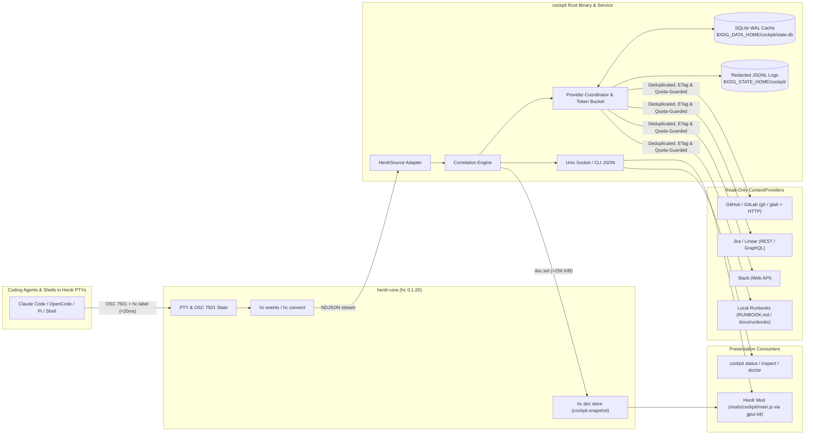

# Cockpit

*   **Author:** notchelvis
*   **Status:** Draft
*   **Date:** 2026-11-13

--------------------------------------------------------------------------------

## Overview

Cockpit is a local-first, read-only dashboard for keeping track of all coding agents running through Herdr (`herdr-core` / `hc`). It consists of two paired components:
1. A native Herdr Desktop (`herdr-app`) mod (`~/.config/herdr-app/mods/cockpit/main.js` and layout `~/.config/herdr-app/layouts/cockpit.json`) rendered with `gpui-kit`.
2. A local Rust CLI binary and background service (`cockpit`) that powers the Herdr mod and also works standalone from the Linux shell when `herdr-app` is closed or not installed.

Cockpit displays every live and recently finished coding agent in one place, highlights agents that are blocked waiting for a human answer or permission approval, and correlates each agent with its related ticket (Jira, Linear), pull/merge request, CI check status, deploy/release status, review state (GitHub `gh` / GitLab `glab`), Slack thread, and local Markdown runbooks. Everything stays on the user's machine with zero external telemetry, making only essential read-only calls to the tools the user has configured. A single command (`cockpit setup`) configures shell hooks, Claude Code, OpenCode, Pi, and Herdr Desktop reversibly.

## The Problem

When a developer runs multiple concurrent coding agents across branches, worktrees, and repositories inside Herdr (`hc`), tracking operational state fragments across several disconnected tools:
* **Missed Human Gates:** While `hc` tracks terminal lifecycle (`live` / `finished`) and OSC 7501 status (`idle`, `working`, `done`, `blocked`, `error`), agents running inside Claude Code, OpenCode, or Pi may lack consistent OSC 7501 hooks or provenance labels, making it easy to miss which specific agent is blocked on a question, permission prompt, or authentication check.
* **Scattered External Context:** Knowing an agent is `working` or `done` in terminal `t7` does not tell the developer whether the related Jira/Linear ticket is in progress, whether the GitHub/GitLab pull request has failing CI checks or pending review comments, whether a deploy or release succeeded, which Slack discussion thread tracks the task, or which local runbook applies to a failure.
* **Rate-Limit & Privacy Risks:** Existing cloud dashboards require sending workspace metadata off-machine, while naive local scripts that poll `gh`, `glab`, Jira, Linear, and Slack per terminal quickly exhaust API quotas (starving the active coding agents that share the user's local OAuth/PAT tokens) and spawn dozens of slow subprocesses per minute.

Cockpit solves this by combining deterministic local provenance (`hc label` + live `foreground.cwd` git state) with an event-gated, deduplicated Rust data service (`cockpit`) that feeds a stateless `gpui-kit` Herdr mod and a standalone CLI.

## Goals

*   **Unified Agent Fleet Visibility:** Display all live and recently finished coding agents from `herdr-core` (`hc events --json` / `hc connect` and `hc ls --all --json`), filtering out plain non-agent shells by default (`reported == false` without `cockpit.*` labels) and pinning `blocked` agents (`auth` > `permission` > `question`) at the top of the attention queue.
*   **Deterministic Multi-Integration Correlation (V1):** Correlate each agent session with its GitHub (`gh`) or GitLab (`glab`) pull/merge request, CI runs, code reviews, deploys, and releases; Jira and Linear tickets; Slack threads; and local Markdown runbooks (`RUNBOOK.md`, `docs/runbooks/`, `.cockpit/runbooks/`) using an explicit confidence tier (`Exact`, `Inferred`, `Ambiguous`, or `Local / No PR`).
*   **Native Herdr Mod + Standalone Rust CLI/Service:** Deliver a stateless `gpui-kit` mod (`~/.config/herdr-app/mods/cockpit/main.js`) and layout (`~/.config/herdr-app/layouts/cockpit.json`) backed by the `cockpit` Rust binary/daemon (`cockpit daemon`, `cockpit status`, `cockpit watch`, `cockpit inspect`, `cockpit doctor`, `cockpit setup`, `cockpit uninstall`).
*   **Strict Local-Only Privacy & API Quota Protection:** Store all cached state and structured logs locally on the machine (`$XDG_DATA_HOME/cockpit/` and `$XDG_STATE_HOME/cockpit/`), deduplicate external queries by canonical resource key, gate refreshes on `hc` state transitions and `.git/HEAD` changes, freeze polling for `finished` agents, and halt background polling when remaining provider quota drops below a 25% reserve floor.
*   **Safe, Idempotent Linux Setup:** Provide `cockpit setup` (supporting `--dry-run`, `--only`, `--verify`, and `cockpit uninstall`) to configure shell hooks, Claude Code, OpenCode, Pi, and Herdr Desktop using disposable drop-in scripts under `~/.config/cockpit/hooks/` and a reversible setup manifest (`~/.local/state/cockpit/setup-manifest.json`).

## Non-Goals

*   **Email and Meetings Integrations in V1:** Email and calendar/meetings views are deferred to Phase 2 (supported later via the extensible `ContextProvider` trait).
*   **Remote State Mutation:** Cockpit V1 is strictly read-only toward external providers; it will never merge PRs, trigger CI/deploys, transition Jira/Linear issues, or post Slack messages.
*   **Automated Agent Steering or Prompt Injection:** Cockpit V1 will not send prompts to agents or bypass permission blocks (`hc send --force`), though it allows safe local navigation (focusing the terminal in Herdr or opening external URLs).
*   **Cloud Relays or External Telemetry:** Cockpit will not use external webhook relays, cloud databases, or analytics/crash reporting services.

## Open Questions

*   None currently open; all initial scope, integration, and architectural boundaries have been resolved during brainstorming.

## Critical User Journeys (CUJs)

### CUJ 1: One-Command Linux Setup Across Shell and Coding Agents

*   **Given**: A Linux machine with `herdr-core` (`hc`) and `gh` installed, optional coding agents (Claude Code, OpenCode, Pi), and optionally `herdr-app`.
*   **When**: The developer runs `cockpit setup --dry-run` to inspect planned changes and then runs `cockpit setup` followed by `cockpit doctor`.
*   **Then**: Cockpit writes self-contained hook scripts under `~/.config/cockpit/hooks/`, surgically registers non-blocking (`<20 ms`) provenance and OSC 7501 hooks for installed tools, installs `~/.config/herdr-app/mods/cockpit/main.js` and `layouts/cockpit.json`, records the rollback manifest at `~/.local/state/cockpit/setup-manifest.json`, and `cockpit doctor` reports healthy `hc` connectivity and provider status (marking unconfigured tools like Jira/Linear/Slack as `Inactive` rather than failed).

### CUJ 2: Spotting and Triaging a Blocked Coding Agent in Herdr

*   **Given**: Three coding agents are running via `hc` across different git worktrees, and one agent (`t7`) pauses on a tool permission prompt or clarifying question, emitting OSC 7501 `status.state = "blocked"`.
*   **When**: `herdr-core` emits the `status` event over `hc events --json` to the `cockpit` daemon.
*   **Then**: Within 250 ms, `cockpit` updates its materialized snapshot (over the local Unix socket and `hc`'s `doc.set` store) and triggers a single prioritized context refresh for `t7`. The Herdr Cockpit mod pins `t7` at the top of the attention queue with its `blocked` reason (`permission` or `question`), branch, PR check summary, and ticket badge, allowing the developer to click the row to focus `t7` or inspect its correlated PR/CI/runbook details in the side drawer.

### CUJ 3: Inspecting Correlated Ticket, PR, CI, Deploy, and Runbook Status

*   **Given**: An agent is working on branch `feat/ENG-42-auth-retry` with an open GitHub PR, a failing CI check (`integration-tests`), a linked Linear/Jira issue `ENG-42`, and a repo runbook at `docs/runbooks/integration-tests.md`.
*   **When**: The developer selects the agent in the Cockpit Herdr panel or runs `cockpit inspect <terminal>` from the shell.
*   **Then**: Cockpit displays the deterministic correlation provenance (`Exact` match for the PR via repo/branch, `Inferred` match for `ENG-42` via branch regex, and matched local runbook `docs/runbooks/integration-tests.md`), along with current PR review status, CI check failures, latest deploy/release status, and quick-access links.

## Technical Plan (Architecture)

### High-Level Architecture

Cockpit separates **source provenance emission**, **state ingestion and external context correlation**, and **UI/CLI presentation** into three decoupled layers so that neither the Herdr `gpui-kit` mod nor the user's shell/agent hooks ever block on network I/O or subprocess spawns:

1.  **Source Provenance & Hook Layer (`~/.config/cockpit/hooks/`)**:
    *   Installed by `cockpit setup` for interactive shells (`bash`, `zsh`, `fish`, `nushell`), Claude Code, OpenCode, and Pi.
    *   On agent turn start, tool permission prompt, question gate, or turn completion, hooks emit standard OSC 7501 status sequences (`working`, `blocked` with `kind: permission | question | auth`, `done`, `idle`) directly to the controlling PTY and asynchronously stamp deterministic local provenance onto the `herdr-core` terminal via `hc label $HC_TERMINAL_ID cockpit.cwd=... cockpit.repo=... cockpit.branch=... cockpit.head=... cockpit.issue=... cockpit.pr=...`.
    *   All hook invocations enforce a hard `<20 ms` execution budget (backgrounded/non-blocking) so a stopped daemon or slow disk never stalls the shell or coding agent.

2.  **Coalescing Rust Daemon & CLI (`cockpit`)**:
    *   Runs as a single-instance per-user service (enforced via `flock` at `$XDG_RUNTIME_DIR/cockpit/daemon.lock`, started on demand by the CLI/mod or via `systemd --user`).
    *   **`HerdrSource` Stream Consumer**: Connects to `herdr-core` via `hc events --json` (or `hc connect` OpenRPC `events.subscribe`), maintaining the live in-memory fleet table of `live` and `finished` terminals and reconciling periodically (every 90s or on `missed` event notification) against `hc ls --all --json`.
    *   **Correlation Engine**: Maps each agent terminal `(address, live_cwd, git_head, git_branch, git_remote, labels)` to canonical external resource keys (`RepoBranchKey`, `PullRequestKey`, `IssueKey`, `SlackThreadKey`, `RunbookPath`) and assigns an explicit confidence tier (`Exact`, `Inferred`, `Ambiguous`, or `LocalOnly`).
    *   **`ContextProvider` Coordinator & Quota Guard**: Executes event-gated, deduplicated fetches across isolated read-only provider adapters (`GitHubProvider`, `GitLabProvider`, `JiraProvider`, `LinearProvider`, `SlackProvider`, `RunbookProvider`). Stores normalized entities and `ETag` / TTL metadata in a local SQLite WAL database (`$XDG_DATA_HOME/cockpit/state.db`).
    *   **Projection Publisher**: Materializes a versioned `CockpitSnapshot` (`schema_version: 1`) and publishes it to:
        1.  A local Unix domain socket (`$XDG_RUNTIME_DIR/cockpit/cockpit.sock`, mode `0600`) streaming initial snapshot + sequence-numbered NDJSON deltas.
        2.  `herdr-core`'s built-in document store (`hc connect` `doc.set` under key `cockpit.snapshot`, bounded under 256 KiB, which automatically emits `doc` events to `herdr-app`).
        3.  Direct CLI subcommands (`cockpit status [--json]`, `cockpit watch`, `cockpit inspect <t>`, `cockpit doctor`).

3.  **Stateless Herdr Desktop Mod (`~/.config/herdr-app/mods/cockpit/main.js` & `layouts/cockpit.json`)**:
    *   Rendered natively inside `herdr-app` via `gpui-kit`.
    *   Contains zero external API logic, zero regex heuristics, and spawns zero `gh`/`glab` polling subprocesses.
    *   Subscribes to the pre-computed `CockpitSnapshot` (via `herdr-app`'s `doc` state or `cockpit watch --json` stream), verifies `schema_version == 1`, and projects the state into a two-tier UI:
        *   **Top/Left Attention Fleet List**: Pinned `blocked` agents first (sorted by `auth` > `permission` > `question` with a 1.5s hysteresis filter against transient flickers), followed by `working` and `idle` agents, and a collapsible `Recent Finished` section.
        *   **Right/Bottom Context Inspector Drawer**: Displays correlated PR checks, review approvals/comments, deploy & release status, Jira/Linear ticket state, Slack thread links, matched local runbooks, correlation provenance (`Exact` vs `Inferred`), and per-provider health/staleness badges.

### Core Data Structures & Domain Model

*   **`AgentRow`**:
    *   `address`: Terminal ID (e.g., `"t7"`), `name`, `parent`: Optional parent terminal ID.
    *   `lifecycle`: `Live` | `Finished { exit_code, reason }`.
    *   `agent_kind`: Detected harness (`ClaudeCode`, `OpenCode`, `Pi`, `Codex`, `CustomAgent`, or `PlainShell`).
    *   `attention_state`: `Blocked { kind: Auth | Permission | Question, message, since_ts }` | `Working` | `Done` | `Idle` | `Error { message }`.
    *   `workspace`: `{ cwd, repo_root, worktree_path, git_branch, git_head_sha, git_remote_url }`.
    *   `correlation_tier`: `Exact` | `Inferred` | `Ambiguous` | `LocalOnly`.
    *   `provenance`: List of `ProvenanceEdge { source: Label | BranchMatch | CommitRegex | RepoPath, key, confidence, explanation }`.
    *   `context`: References to normalized `PullRequestRef`, `CiSummary`, `DeployReleaseRef`, `IssueRef`, `SlackThreadRef`, and `Vec<RunbookRef>`.
*   **`ContextProvider` Trait**:
    *   Uniform async Rust trait implemented by `github`, `gitlab`, `jira`, `linear`, `slack`, and `runbooks`:
        *   `fn id(&self) -> ProviderId`
        *   `async fn check_health(&self) -> ProviderHealth` (`Ready`, `Inactive`, `AuthExpired`, `RateLimited { reset_at }`, `Offline`, `Error`)
        *   `async fn fetch_by_keys(&self, keys: &[ResourceKey], cache: &CacheStore) -> ProviderBatchResult`

### Correlation Cascade & Event-Gated Refresh Rules

1.  **Correlation Precedence**:
    *   **Tier 1 (`Exact`)**: Explicit `hc` terminal labels (`cockpit.pr`, `cockpit.issue`, `cockpit.slack`, `cockpit.runbook`) or an exact `(git_remote_url, git_branch, git_head_sha)` match to an open PR/MR in the same repository/worktree.
    *   **Tier 2 (`Inferred`)**: Deterministic ticket key regex (`\b[A-Z][A-Z0-9_]{1,9}-\d+\b`) extracted from the checked-out branch name, latest commit subject on the branch, or terminal title/labels; plus local runbooks matched by path or frontmatter tags (e.g., failing CI job name or service directory).
    *   **Tier 3 (`Ambiguous`)**: Multiple open PRs or issues match the same branch/key; Cockpit lists candidates with a warning badge rather than guessing.
    *   **Tier 4 (`LocalOnly`)**: Agent is on `main`/`master` with no branch PR, in an unpushed local branch, or in a non-git directory. Renders cleanly as `Local / No PR` with zero external API queries.
2.  **Event-Gated Refresh Cadence**:
    *   External fetches trigger on: (a) terminal creation or `foreground.cwd` / `.git/HEAD` change, (b) `hc` `turn` increment, (c) `status.state` transitioning to `blocked`, `done`, or `error`, or (d) explicit user refresh (`cockpit status --refresh`).
    *   While an agent is idle or working without state transitions, background refreshes decay exponentially (30s $\rightarrow$ 60s $\rightarrow$ 180s $\rightarrow$ 600s) and stop completely for `finished` terminals and closed/merged PRs.
    *   If any provider's remaining rate-limit quota drops below 25%, background refreshes for that provider pause automatically until the reset window.

--------------------------------------------------------------------------------

## Non-Functional Requirements

*   **Security & Privacy**:
    *   Zero third-party telemetry, analytics, or external crash reporting.
    *   Credentials for Jira, Linear, and Slack are read exclusively from the Linux Secret Service (`libsecret` / OS keyring), environment variables (`COCKPIT_LINEAR_TOKEN`, `COCKPIT_JIRA_TOKEN`, `COCKPIT_SLACK_TOKEN`), or user-configured secret commands—never written in plaintext to `~/.config/cockpit/config.toml`. GitHub and GitLab reuse existing `gh auth token` and `glab` CLI authentication in read-only mode.
    *   Local JSONL logs (`$XDG_STATE_HOME/cockpit/cockpit.log`) apply a mandatory regex and header scrubbing filter to strip Bearer tokens, PATs (`ghp_`, `github_pat_`, `glpat-`, `lin_api_`, `xoxb-`, `xoxp-`), and cookies before writing to disk.
*   **Performance & Resource Footprint**:
    *   Hook execution latency in shells and coding agents must remain `<20 ms` p99.
    *   Daemon idle memory footprint `<35 MB` RSS; SQLite WAL cache (`$XDG_DATA_HOME/cockpit/state.db`) and rotated logs capped at `<50 MB` total disk usage with automatic TTL pruning (finished terminals older than 72 hours pruned from hot snapshot).
    *   External CLI fallback workers bounded to at most 3 concurrent non-interactive subprocesses (`stdin` closed, `GH_PROMPT_DISABLED=1`, `GLAB_NO_PROMPT=1`, 10s hard timeout).
*   **Rollout, Idempotency & Rollback**:
    *   `cockpit setup` validates target config files before editing, skips uninstalled tools cleanly, uses atomic temp-file renames, and records pre-setup hashes and owned keys in `~/.local/state/cockpit/setup-manifest.json`.
    *   `cockpit uninstall` (or `cockpit setup --undo`) removes all Cockpit-managed hooks, fenced shell blocks (`# >>> cockpit >>>`), and mod files without clobbering unrelated user edits.

## Alternatives Considered

### Alternative A: Standalone GPUI Desktop App (Separate Binary Window)

*   **Pros**: Full control over the native GPUI window lifecycle without depending on `herdr-app`'s mod host or layout schema.
*   **Cons**: Forces the developer to alt-tab between `herdr-app` (where all agent terminals live) and a second desktop window, breaking the single-pane workflow and duplicating terminal focus management.
*   **Reason for Rejection**: Rejected by author: Since Cockpit is used from within Herdr Desktop, shipping the UI as a native Herdr mod (`~/.config/herdr-app/mods/cockpit/main.js` + layout) backed by the `cockpit` Rust CLI/service keeps all agent terminals and the fleet dashboard unified inside Herdr while preserving standalone CLI operation.

### Alternative B: Pure JavaScript Mod Without a Rust CLI/Service (`main.js` Polling CLIs Directly)

*   **Pros**: Single runtime (JavaScript only) with no background daemon or Unix domain socket to manage.
*   **Cons**: Spawning `hc`, `gh`, `glab`, and HTTP requests directly inside `herdr-app`'s JS mod loop causes UI frame drops, loses state and ETag caches across mod hot-reloads, cannot run on headless Linux machines where `herdr-app` is absent, and lacks a standalone CLI (`cockpit status`, `cockpit inspect`, `cockpit doctor`, `cockpit setup`).
*   **Reason for Rejection**: Rejected by author: Extracting ingestion, correlation, rate-limit protection, and setup management into the `cockpit` Rust binary/service guarantees a responsive `gpui-kit` UI and full CLI usability on any Linux host.

### Alternative C: Fuzzy Full-Text Search Across Providers for Unmatched Agents

*   **Pros**: Could occasionally discover related Slack threads or Jira/Linear issues even when an agent's branch name or terminal labels omit the ticket ID.
*   **Cons**: Targets the lowest-quota endpoints across providers (30 req/min on GitHub Search, 20 req/min on Slack `search.messages`), rapidly exhausting API budgets shared with live coding agents and producing false-positive matches in monorepos.
*   **Reason for Rejection**: Rejected by author: Restricting automatic correlation to deterministic local identifiers (`hc label` provenance, checked-out branch/commit regexes, and `foreground.cwd` git remote matching) with negative caching protects API quotas and keeps correlation trustworthy.

### Alternative D: Including Email and Calendar/Meetings in V1

*   **Pros**: Delivers the complete personal productivity surface in the initial release.
*   **Cons**: Requires integrating IMAP/JMAP/OAuth mail and CalDAV/Google/Microsoft calendar providers before the core coding-agent loop (PRs, CI, deploys, tickets, Slack, runbooks) is validated.
*   **Reason for Rejection**: Rejected by author: Deferred to Phase 2 so V1 focuses on the core engineering integrations (`gh`/`glab`, Jira, Linear, Slack, and local runbooks) behind an extensible `ContextProvider` trait.

--------------------------------------------------------------------------------

### Additional Resources

*   Herdr Core (`hc 0.1.20`) manual and OpenRPC schema (`hc --skill`, `hc schema`)
*   EGM Ideation Brief: [concepts_brief.md](./concepts_brief.md)

### Future Improvements

*   **Phase 2 Providers (Email & Meetings)**: Add read-only `EmailProvider` (local Maildir / JMAP / IMAP unread mentions) and `CalendarProvider` (upcoming meetings and on-call shifts from local `.ics` / CalDAV) implementing the `ContextProvider` trait.
*   **Cross-Machine Fleet Aggregation**: Use `hc machine ls` to correlate agents running on remote SSH machines registered in `herdr-core` alongside local agents.

--------------------------------------------------------------------------------

## Detailed Implementation Plan

### Target Files to Create/Modify

#### 1. `Cargo.toml` (Create)

*   **Type / Scope**: Rust Package Manifest
*   **Proposed Changes**: Define the `cockpit` binary and library crate (`edition = "2021"`). Declare dependencies for CLI parsing (`clap` with `derive`), async runtime (`tokio`), serialization (`serde`, `serde_json`, `toml_edit`), local caching (`rusqlite` with `bundled` feature for SQLite WAL), HTTP client (`reqwest` with `json` and `rustls-tls`), structured logging (`tracing`, `tracing-subscriber`), regex (`regex`), and filesystem/XDG paths (`dirs` or standard XDG resolution). Rationale: Provides the build and dependency foundation for the standalone Rust CLI and background service.

#### 2. `src/main.rs` (Create)

*   **Type / Scope**: Rust CLI Entrypoint
*   **Proposed Changes**: Implement the `clap` CLI router supporting subcommands:
    *   `cockpit daemon [--once] [--socket <path>]` — runs the single-instance background service (`flock` guarded) or a single snapshot cycle (`--once`).
    *   `cockpit status [--json] [--refresh] [--all]` — prints the formatted terminal/agent dashboard table or machine-readable `CockpitSnapshot` JSON.
    *   `cockpit watch [--json]` — streams live `CockpitSnapshot` and incremental NDJSON deltas for `herdr-app` or terminal watchers.
    *   `cockpit inspect <terminal> [--json]` — prints detailed correlation provenance (`Exact`, `Inferred`, `Ambiguous`, `LocalOnly`), matched keys, and provider state for a single `hc` terminal address or name.
    *   `cockpit doctor [--json] [--bundle <path>]` — verifies `hc` version/connectivity, hook integrity across shell/Claude Code/OpenCode/Pi, Herdr mod installation/version match, and per-provider authentication and rate-limit health.
    *   `cockpit setup [--dry-run] [--only <targets>] [--skip <targets>] [--verify] [--undo] [--set-default-layout]` — executes idempotent setup or rollback.
    *   `cockpit uninstall [--dry-run] [--force]` — alias for `cockpit setup --undo` that cleanly removes all Cockpit-managed hooks, mod files, and manifest entries.
    *   `cockpit logs [--agent <id>] [--provider <name>] [--since <duration>]` — tails redacted local structured logs.
    *   Rationale: Exposes a unified CLI contract for both human operators and the Herdr Desktop mod.

#### 3. `src/lib.rs` (Create)

*   **Type / Scope**: Rust Library Root
*   **Proposed Changes**: Export internal modules (`model`, `config`, `logging`, `herdr`, `correlate`, `store`, `providers`, `daemon`, `setup`, `doctor`, `assets`) so integration tests can exercise every subsystem directly. Rationale: Keeps business logic testable independent of CLI argument parsing.

#### 4. `src/model.rs` (Create)

*   **Type / Scope**: Rust Domain & ViewModel Schema
*   **Proposed Changes**: Define versioned serializable structs (`SNAPSHOT_SCHEMA_VERSION: u32 = 1`):
    *   `CockpitSnapshot { schema_version, cockpit_version, generated_at, daemon_pid, herdr_connected, agents: Vec<AgentRow>, providers: BTreeMap<ProviderId, ProviderHealth>, summary: FleetSummary }`
    *   `AgentRow`, `AgentLifecycle` (`Live`, `Finished`), `AttentionState` (`Blocked`, `Working`, `Done`, `Idle`, `Error`), `BlockedKind` (`Auth`, `Permission`, `Question`), `CorrelationTier` (`Exact`, `Inferred`, `Ambiguous`, `LocalOnly`), `ProvenanceEdge`, and normalized external entity structs (`PullRequestRef`, `CiSummary`, `ReviewSummary`, `DeployReleaseRef`, `IssueRef`, `SlackThreadRef`, `RunbookRef`).
    *   Use `#[serde(default)]` and forward-compatible enum fallbacks (`#[serde(other)]`) for external `hc` payloads.
    *   Rationale: Establishes the strict, versioned schema shared by the Rust daemon, SQLite store, `hc` document store, and `mods/cockpit/main.js`.

#### 5. `src/config.rs` (Create)

*   **Type / Scope**: Rust Configuration & Path Resolution
*   **Proposed Changes**: Load and validate `~/.config/cockpit/config.toml` (`schema_version = 1`, ignoring unknown fields with a logged warning for downgrade safety). Resolve XDG directories (`$XDG_CONFIG_HOME/cockpit`, `$XDG_DATA_HOME/cockpit`, `$XDG_STATE_HOME/cockpit`, `$XDG_RUNTIME_DIR/cockpit`). Resolve provider credentials strictly from environment variables (`COCKPIT_JIRA_TOKEN`, `COCKPIT_LINEAR_TOKEN`, `COCKPIT_SLACK_TOKEN`), secret helper commands (`secret_command`), or host CLIs (`gh auth token`, `glab`), rejecting plaintext secret fields in `config.toml`. Rationale: Enforces local privacy, credential hygiene, and forward/backward config compatibility.

#### 6. `src/logging.rs` (Create)

*   **Type / Scope**: Local Structured Logging & Secret Redaction
*   **Proposed Changes**: Configure `tracing-subscriber` to write bounded, size-rotated JSONL logs to `$XDG_STATE_HOME/cockpit/cockpit.log` with correlation fields (`agent_id`, `event_seq`, `provider`, `span_id`). Implement `redact_secrets(input: &str) -> String` that scrubs `Authorization`/`Bearer` headers and token prefixes (`ghp_`, `github_pat_`, `glpat-`, `lin_api_`, `xoxb-`, `xoxp-`, `ATATT3x`) before any log line or diagnostic bundle is written. Rationale: Provides local debuggability without risking credential leakage on disk.

#### 7. `src/herdr.rs` (Create)

*   **Type / Scope**: `herdr-core` (`hc`) Adapter
*   **Proposed Changes**: Implement `HerdrClient` wrapping `hc` (`herdr-core 0.1.20+`):
    *   `probe_version()` and `list_terminals_all()` via `hc ls --all --json` (with closed `stdin` and 5s timeout).
    *   `subscribe_events()` spawning `hc events --json`, parsing initial snapshot, incremental `created`, `status`, `turn`, `labels`, `finished`, `removed`, `doc`, and `missed` events.
    *   `publish_doc_snapshot(&CockpitSnapshot)` writing a compact JSON projection (<256 KiB) to `herdr-core` via `hc connect` (`doc.set` RPC) so `herdr-app` receives automatic `doc` events.
    *   Apply the 1.5s hysteresis filter for transient `blocked` flickers and roll up child-terminal blocks under `parent` terminal references.
    *   Rationale: Isolates all `herdr-core` CLI and OpenRPC protocol details behind one testable adapter.

#### 8. `src/correlate.rs` (Create)

*   **Type / Scope**: Deterministic Correlation Engine
*   **Proposed Changes**: Implement workspace git introspection (resolving repo root, worktree path, checked-out branch, `HEAD` SHA, and `remote.origin.url` from `foreground.cwd` or `cwd` without spawning heavy subprocesses where `.git/HEAD` can be read directly, with `git rev-parse` fallback). Implement the 4-tier correlation cascade (`Exact` from `cockpit.*` labels or unique `(repo, branch)` PR match $\rightarrow$ `Inferred` from branch/commit ticket regex `\b[A-Z][A-Z0-9_]{1,9}-\d+\b` and repo runbooks $\rightarrow$ `Ambiguous` $\rightarrow$ `LocalOnly`) and record `Vec<ProvenanceEdge>` for `cockpit inspect`. Filter out plain non-agent shells (`reported == false` and no `cockpit.*` labels) unless `--all` is requested. Rationale: Guarantees deterministic, transparent linking across worktrees, branch switches, and no-PR directories.

#### 9. `src/store.rs` (Create)

*   **Type / Scope**: SQLite WAL Cache & Quota Ledger
*   **Proposed Changes**: Manage `$XDG_DATA_HOME/cockpit/state.db` (`PRAGMA journal_mode=WAL; PRAGMA user_version=1;`). Create normalized tables: `cached_entities(provider, resource_key, payload_json, etag, fetched_at, expires_at, is_negative)`, `provider_quotas(provider, remaining, limit_total, reset_at, last_error_kind, last_error_msg, last_success_at)`, and `agent_history(address, snapshot_json, updated_at)`. Implement automatic pruning of finished sessions and expired cache entries older than 72 hours. Rationale: Prevents duplicate API fetches across agents sharing the same PR/ticket and bounds local disk growth.

#### 10. `src/providers/mod.rs` (Create)

*   **Type / Scope**: Uniform `ContextProvider` Trait & Coordinator
*   **Proposed Changes**: Define the `ContextProvider` trait, `ResourceKey` enum (`RepoBranch`, `PullRequest`, `Issue`, `SlackThread`, `RunbookDir`), typed `ProviderErrorKind` (`AuthExpired`, `RateLimited`, `NotFound`, `BinaryMissing`, `NetworkOffline`, `SchemaError`), and `ProviderCoordinator`. Enforce single-flight request deduplication, per-provider token buckets, `Retry-After` circuit breakers, the 25% quota reserve floor, and freezing of refreshes for `finished` agents and merged/closed PRs. Rationale: Decouples core state management from individual third-party APIs and enforces quota economics.

#### 11. `src/providers/github.rs` (Create)

*   **Type / Scope**: GitHub (`gh` + REST/GraphQL) Read-Only Provider
*   **Proposed Changes**: Discover authentication via `gh auth status` / `gh auth token` (non-interactive, `GH_PROMPT_DISABLED=1`). Query PR state, review decisions, CI check runs/statusRollup, deployment status, and latest release for deduplicated `(owner, repo, branch_or_pr)` keys using conditional `ETag` requests or `gh pr view --json` fallback. Parse `X-RateLimit-Remaining` and `X-RateLimit-Reset`. Rationale: Delivers GitHub PR, CI, review, deploy, and release tracking with minimal quota consumption.

#### 12. `src/providers/gitlab.rs` (Create)

*   **Type / Scope**: GitLab (`glab` + REST/GraphQL) Read-Only Provider
*   **Proposed Changes**: Detect GitLab remotes and check `glab` / `GITLAB_TOKEN` availability (reporting `ProviderHealth::Inactive` when neither is present). Fetch merge request status, pipeline status, approvals, environments/deployments, and releases in read-only mode. Rationale: Supports GitLab repositories without producing errors when `glab` is not installed.

#### 13. `src/providers/jira.rs` (Create)

*   **Type / Scope**: Jira Read-Only Provider
*   **Proposed Changes**: When `jira_base_url` and credentials (`COCKPIT_JIRA_TOKEN` / secret command) are configured, fetch deduplicated issue keys (`/rest/api/3/issue/<KEY>?fields=summary,status,assignee,priority,updated`) with `ETag`/TTL caching and negative-lookup caching (`not_found` cached for 15 minutes). When unconfigured, report `ProviderHealth::Inactive`. Rationale: Provides Jira ticket status with zero noise for users who do not use Jira.

#### 14. `src/providers/linear.rs` (Create)

*   **Type / Scope**: Linear Read-Only Provider
*   **Proposed Changes**: When `COCKPIT_LINEAR_TOKEN` (or secret command) is configured, execute batched read-only GraphQL queries against `https://api.linear.app/graphql` for extracted `IssueKey` identifiers (fetching title, state name/type, assignee, priority, URL) while tracking `X-RateLimit-Requests-Remaining` and `X-RateLimit-Complexity-Remaining`. Report `ProviderHealth::Inactive` when unconfigured. Rationale: Batches Linear issue lookups to protect GraphQL complexity quotas.

#### 15. `src/providers/slack.rs` (Create)

*   **Type / Scope**: Slack Read-Only Provider
*   **Proposed Changes**: When `COCKPIT_SLACK_TOKEN` is configured, resolve explicit Slack thread URLs or `cockpit.slack` labels via `conversations.replies` (strictly forbidding background `search.messages` calls) and honor HTTP 429 `Retry-After` headers. Even without a token, parse and attach explicit Slack deep links from labels or PR descriptions as clickable `SlackThreadRef` URLs. Rationale: Surfaces linked Slack discussions without hitting Tier 2 search rate limits.

#### 16. `src/providers/runbooks.rs` (Create)

*   **Type / Scope**: Local Markdown Runbooks Provider
*   **Proposed Changes**: Perform bounded, gitignore-aware discovery of `RUNBOOK.md`, `docs/runbooks/*.md`, `.cockpit/runbooks/*.md`, and `~/.config/cockpit/runbooks/*.md` (max depth 3, max file size 256 KiB, zero script execution). Parse optional YAML frontmatter (`title`, `tags`, `service`, `ci_job`, `branch_pattern`) and first heading/summary paragraph to match runbooks against the agent's repo, working subdirectory, or failing CI check names. Rationale: Gives instant access to relevant operational runbooks completely offline.

#### 17. `src/daemon.rs` (Create)

*   **Type / Scope**: Single-Instance Background Service & IPC Server
*   **Proposed Changes**: Acquire an exclusive advisory lock on `$XDG_RUNTIME_DIR/cockpit/daemon.lock`, bind Unix domain socket `$XDG_RUNTIME_DIR/cockpit/cockpit.sock` (`0600`), run the `HerdrClient` event stream loop + 90s reconciliation timer + event-gated `ProviderCoordinator`, and broadcast `CockpitSnapshot` updates to connected socket clients and `hc` `doc.set`. Rationale: Eliminates split-brain polling and serves sub-millisecond state reads to both the CLI and Herdr mod.

#### 18. `src/assets.rs` (Create)

*   **Type / Scope**: Embedded Herdr Mod, Layout, and Hook Assets
*   **Proposed Changes**: Embed the canonical `mods/cockpit/main.js`, `layouts/cockpit.json`, and shell/agent hook scripts into the Rust binary (with SHA-256 asset version hashes) so `cockpit setup` and `cockpit doctor` work from a single self-contained binary. Rationale: Prevents version skew between the installed `cockpit` binary and the Herdr mod/hook files.

#### 19. `assets/herdr-app/mods/cockpit/main.js` (Create)

*   **Type / Scope**: Herdr Desktop (`herdr-app`) Mod (`gpui-kit`)
*   **Proposed Changes**: Implement the stateless `gpui-kit` Cockpit mod:
    *   Verify `snapshot.schema_version == 1` (displaying a clear version-mismatch banner prompting `cockpit setup` if mismatched).
    *   Render the compact Attention Fleet List (pinned `Blocked` section with `auth`/`permission`/`question` badges, `Working` / `Idle` section, collapsible `Recent Finished` section, and quick filter tabs).
    *   Render the Context Inspector Drawer for the selected agent: Ticket card (Jira/Linear), Pull Request + Reviews + CI checks + Deploy/Release card (`gh`/`glab` or `Local / No PR`), Slack thread links, Local Runbooks viewer, Correlation Provenance badge (`Exact` / `Inferred`), and Provider Health/Staleness footer.
    *   Wire safe local navigation actions: clicking an agent focuses its terminal pane in Herdr; clicking external links opens the URL.
    *   Rationale: Delivers the native GPUI dashboard inside Herdr Desktop with zero blocking I/O.

#### 20. `assets/herdr-app/layouts/cockpit.json` (Create)

*   **Type / Scope**: Herdr Desktop Layout Definition
*   **Proposed Changes**: Define the `cockpit` layout composition pairing the active Herdr terminal workspace with the `cockpit` mod panel without overwriting the user's `default` layout. Rationale: Allows switching to the Cockpit layout via `Ctrl+Shift+L` in `herdr-app` while preserving existing user layouts.

#### 21. `src/setup.rs` (Create)

*   **Type / Scope**: Idempotent Linux Setup & Rollback Engine
*   **Proposed Changes**: Implement `cockpit setup` and `cockpit uninstall`:
    *   Write disposable, `<20 ms` hook scripts under `~/.config/cockpit/hooks/` (`shell.sh`, `shell.fish`, `shell.nu`, `claude-hook.sh`, `opencode-plugin.js`, `pi-hook.sh`) guarded by `command -v hc` / `command -v cockpit`.
    *   Apply fenced block edits (`# >>> cockpit managed >>>` ... `# <<< cockpit managed <<<`) to `.bashrc` / `.zshrc` / `config.fish` / `config.nu`.
    *   Perform surgical, format-preserving JSON merges into `~/.claude/settings.json`, `~/.config/opencode/opencode.json`, and `~/.pi/agent/settings.json` using deterministic `cockpit-osc7501` identifiers, skipping uninstalled tools cleanly.
    *   Install `~/.config/herdr-app/mods/cockpit/main.js` and `~/.config/herdr-app/layouts/cockpit.json` safely even on headless hosts where `herdr-app` is not yet installed.
    *   Persist pre-edit SHA-256 hashes and owned keys in `~/.local/state/cockpit/setup-manifest.json` using atomic temp-file writes + `fsync` + rename, and implement `--dry-run`, `--only`, `--skip`, `--verify`, and `--undo`.
    *   Rationale: Ensures zero-risk onboarding and clean uninstallability across Linux setups.

#### 22. `src/doctor.rs` (Create)

*   **Type / Scope**: Diagnostic & Health Verification Command
*   **Proposed Changes**: Implement `cockpit doctor [--json] [--bundle <path>]` checking: (1) `hc` binary presence, version (`>= 0.1.20`), and live daemon connectivity, (2) hook script signatures and config registration across shell, Claude Code, OpenCode, and Pi, (3) Herdr mod asset hash alignment with binary version, (4) SQLite store and socket health, and (5) per-provider auth and rate-limit status (`gh`, `glab`, Jira, Linear, Slack, runbooks). Support generating a secret-redacted diagnostic JSON bundle. Rationale: Eliminates troubleshooting blind spots when operating strictly locally.

#### 23. `tests/integration_tests.rs` (Create)

*   **Type / Scope**: Automated Integration & Contract Tests
*   **Proposed Changes**: Test:
    *   `hc` JSON deserialization against real `hc ls --all --json` and `hc schema` structures, including forward-compatibility with unknown enum variants.
    *   4-tier correlation cascade across worktrees, branch switches, `cockpit.*` labels, `PROJ-123` regexes, local runbooks, and `Local / No PR` directories.
    *   Provider token-bucket rate limiting, 25% quota reserve floor pausing, ETag `304 Not Modified` handling, and negative caching.
    *   Idempotent `cockpit setup`, `--dry-run`, `--verify`, and `cockpit uninstall` rollback in isolated temporary `HOME`/`XDG` directories (verifying existing keys in `settings.json` and `opencode.json` are preserved byte-for-byte on rollback).
    *   Secret redaction filter scrubbing tokens from logs and diagnostic bundles.
    *   Rationale: Verifies all functional and non-functional invariants automatically.

#### 24. `README.md` (Modify)

*   **Type / Scope**: Project Documentation
*   **Proposed Changes**: Document Cockpit architecture, Linux installation and `cockpit setup` usage across Herdr, Claude Code, OpenCode, Pi, and shell, optional environment variables for Jira/Linear/Slack, local runbook conventions, and CLI commands (`cockpit status`, `cockpit watch`, `cockpit inspect`, `cockpit doctor`, `cockpit uninstall`). Rationale: Provides clear onboarding and reference documentation.

### Verification Plan

*   **Compilation/Build**: `cargo build --release` must compile cleanly with zero errors.
*   **Unit & Integration Tests**: `cargo test` must pass all unit and integration tests in `src/` and `tests/integration_tests.rs`.
*   **Static Analysis & Linting**: `cargo clippy --all-targets -- -D warnings` and `cargo fmt --check` must pass with zero warnings.
*   **End-to-End Live Environment Verification**:
    *   Run `cockpit setup --dry-run`, `cockpit setup`, `cockpit setup --verify`, and `cockpit doctor --json` against the live Linux environment (`hc 0.1.20`, `gh`, `~/.claude/settings.json`, `~/.config/opencode/opencode.json`, `~/.pi/agent/settings.json`).
    *   Verify live `hc` terminal ingestion and correlation via `cockpit status`, `cockpit status --json`, and `cockpit inspect t7`.
    *   Verify clean rollback and re-setup idempotency.

--------------------------------------------------------------------------------

*Drafted with EGM*
