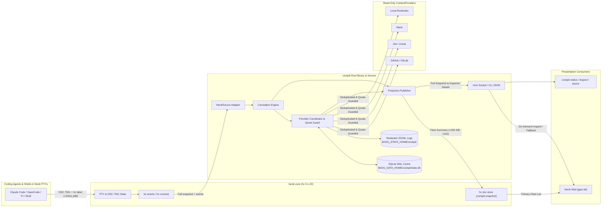

# Cockpit

*   **Author:** notchelvis
*   **Status:** Approved
*   **Date:** 2026-11-13

--------------------------------------------------------------------------------

## Overview

Cockpit is a local-first, read-only dashboard to track coding agents running through Herdr (`herdr-core` / `hc`, an open-source persistent terminal runtime for coding agents at https://herdr.dev). It consists of two paired components:
1.  An in-process Herdr Desktop (`herdr-app`) mod (`~/.config/herdr-app/mods/cockpit/main.js` and layout `~/.config/herdr-app/layouts/cockpit.json`) rendered with Herdr's `gpui-kit` UI library.
2.  A local Rust CLI binary and background service (`cockpit`) that powers the Herdr mod and operates standalone from the Linux shell when `herdr-app` is closed or not installed.

Cockpit displays live and recently finished coding agents, highlights agents blocked on a human answer or permission approval, and correlates each agent with its related ticket (Jira, Linear), pull/merge request, CI checks, deploy/release status, review state (GitHub `gh` / GitLab `glab`), Slack thread, and local Markdown runbooks. All cached state, correlation logic, and structured logs remain on the user's machine with zero third-party telemetry; outbound network traffic is restricted to read-only API requests to the integrations the user has configured. A setup command (`cockpit setup`) configures shell helpers, Claude Code, OpenCode, Pi, and Herdr Desktop with a manifest-backed rollback path.

--------------------------------------------------------------------------------

## The Problem

When a developer runs multiple concurrent coding agents across branches, worktrees, and repositories inside Herdr (`hc`), operational state fragments across disconnected tools:
*   **Missed Human Gates:** `hc` tracks terminal lifecycle (`live` / `finished`) and `OSC 7501` program status reports (`idle`, `working`, `done`, `blocked`, `error`). However, agents running inside Claude Code, OpenCode, or Pi may lack consistent `OSC 7501` hooks or provenance labels, obscuring which agent is waiting on a question, permission prompt, or authentication check.
*   **Scattered External Context:** Knowing an agent is `working` or `done` in a terminal does not show whether its Jira or Linear ticket is in progress, whether its GitHub or GitLab pull request has failing CI checks or pending review comments, whether a deploy or release succeeded, which Slack thread tracks the task, or which local runbook applies to a failure.
*   **Rate-Limit & Subprocess Overhead:** Cloud dashboards require sending workspace metadata to third-party servers. Conversely, per-terminal polling scripts scale at $O((N_{\text{live}} + M_{\text{finished}}) \times K_{\text{integrations}})$, which can exhaust shared API quotas (such as GitHub's 5,000 req/hr core limit and 30 req/min Search limit, or Slack's 20–50 req/min Tier 2/3 limits) and incur 80–250 ms CPU and 30–60 MB RSS per spawned CLI subprocess.

Cockpit addresses this by combining local terminal provenance (`hc label` metadata and live foreground working-directory git state) with an event-gated, deduplicated Rust data service (`cockpit`) that feeds both the `gpui-kit` Herdr mod and the standalone CLI.

--------------------------------------------------------------------------------

## Goals

*   **Unified Agent Fleet Visibility:** Ingest live and recently finished coding agents from `herdr-core` via its event stream and RPC interface. Exclude plain non-agent shells by default (terminals that have never reported an `OSC 7501` status and carry no `cockpit.*` labels), and pin `blocked` agents (`auth` > `permission` > `question`) at the top of the attention queue.
*   **Multi-Integration Correlation (V1):** Correlate each agent session with its configured providers (GitHub, GitLab, Jira, Linear, Slack, and local Markdown runbooks) using a four-tier confidence model (`Exact`, `Inferred`, `Ambiguous`, or `LocalOnly`).
*   **Herdr Mod + Standalone Rust CLI/Service:** Deliver a stateless `gpui-kit` mod and layout alongside the `cockpit` Rust binary (`daemon`, `status`, `watch`, `inspect`, `label`, `doctor`, `setup`, `uninstall`, `logs`).
*   **Local Storage & API Quota Protection:** Keep cached provider state and logs on-machine, deduplicate external queries by canonical resource key, trigger refreshes on `hc` state transitions and active repository HEAD changes, freeze polling for `finished` agents, and enforce per-provider rate limits, circuit breakers, and remaining-quota reserve floors.
*   **Idempotent, Reversible Linux Setup:** Provide `cockpit setup` (and `cockpit uninstall`) to install isolated hook scripts, register agent hooks and Herdr mod files, and record pre-change state in a local rollback manifest.

--------------------------------------------------------------------------------

## Non-Goals

*   **Email and Meetings Integrations in V1:** Email and calendar/meetings integrations are deferred to Phase 2 via the `ContextProvider` trait.
*   **Remote State Mutation:** Cockpit V1 performs only read-only requests toward external providers; it does not merge PRs, trigger CI/deploys, transition tickets, or post Slack messages.
*   **Automated Agent Steering or Prompt Injection:** Cockpit V1 does not send prompts to agents or bypass permission blocks (`hc send --force`), though it supports local navigation (focusing a terminal pane in Herdr or opening external URLs).
*   **Cloud Relays or External Telemetry:** Cockpit does not use external webhook relays, cloud databases, or analytics/crash reporting services.

--------------------------------------------------------------------------------

## Open Questions

*   **Headless `herdr-app` Mod Host Availability:** On headless Linux machines where `herdr-core` (`hc`) is installed without `herdr-app` (including this build host), the desktop mod runtime cannot be launched interactively. Cockpit defines explicit JS module export and layout JSON contracts in the implementation plan, verifies embedded asset integrity in `cockpit doctor`, and skips mutating `herdr-app/settings.json` unless `~/.config/herdr-app/` exists or `--only herdr-mod` is requested.

--------------------------------------------------------------------------------

## Critical User Journeys (CUJs)

### CUJ 1: One-Command Linux Setup Across Shell and Coding Agents

*   **Given**: A Linux machine with `herdr-core` (`hc`) and `gh` installed, optional coding agents (Claude Code, OpenCode, Pi), and optionally `herdr-app`.
*   **When**: The developer runs `cockpit setup --dry-run` to preview planned file changes and then runs `cockpit setup` followed by `cockpit doctor`.
*   **Then**: Cockpit writes isolated hook scripts, registers non-blocking (`<20 ms` p99) provenance and `OSC 7501` hooks for installed coding agents plus an opt-in shell helper, installs the Herdr mod and layout files, records the rollback manifest, and `cockpit doctor` reports `hc` connectivity and provider status (showing unconfigured tools as `Inactive` rather than failed).

### CUJ 2: Spotting and Triaging a Blocked Coding Agent in Herdr

*   **Given**: Three coding agents are running via `hc` across different git worktrees, and one agent (`t7`) pauses on a tool permission prompt or clarifying question, emitting `OSC 7501` `blocked` status.
*   **When**: `herdr-core` emits the status change event to the `cockpit` daemon.
*   **Then**: Within 250 ms (`p99` local propagation), `cockpit` updates its materialized summary projection in `hc`'s `doc` store and local Unix socket, and triggers a single prioritized external context refresh for `t7`. The Herdr Cockpit mod pins `t7` at the top of the attention queue with its `blocked` reason (`permission` or `question`), branch, PR check summary, and ticket badge, allowing the developer to focus `t7` or open the inspector drawer for detailed checks and runbooks.

### CUJ 3: Inspecting Correlated Ticket, PR, CI, Deploy, and Runbook Status

*   **Given**: An agent is working on branch `feat/ENG-42-auth-retry` with an open GitHub PR, a failing CI check (`integration-tests`), a linked issue `ENG-42`, and a repository runbook at `docs/runbooks/integration-tests.md`.
*   **When**: The developer selects the agent in the Cockpit Herdr panel or runs `cockpit inspect <terminal>` from the shell.
*   **Then**: Cockpit displays the correlation provenance (`Exact` match for the PR via normalized repository and branch, `Inferred` match for `ENG-42` via branch ticket pattern, and matched local runbook `docs/runbooks/integration-tests.md`), along with current PR review status, CI check failures, latest deploy/release status, and external links.

--------------------------------------------------------------------------------

## Technical Plan (Architecture)

### High-Level Architecture

Cockpit separates **source provenance emission**, **state ingestion and external context correlation**, and **UI/CLI presentation** into three decoupled layers so that UI rendering and agent hooks operate asynchronously without waiting on network I/O:

1.  **Source Provenance & Hook Layer (`~/.config/cockpit/hooks/`)**:
    *   **Coding Agent Hooks (Claude Code, OpenCode, Pi)**: Installed into each agent's native extension/hook mechanism. On turn start, permission/question prompts, or turn completion, agent hooks emit `OSC 7501` status updates to `/dev/tty` (when a controlling TTY is present and the agent does not already emit native `OSC 7501`) and asynchronously tag the terminal via `hc label`.
    *   **Interactive Shell Helper (`bash`, `zsh`, `fish`, `nushell`)**: Defines an opt-in shell function (`cockpit-tag`) so a developer can manually attach ticket/PR labels to an interactive terminal without automatically emitting `OSC 7501` or `cockpit.*` labels on every plain shell prompt (preserving the plain-shell exclusion filter).
    *   All hooks run asynchronously with a `<20 ms` `p99` execution budget and never resolve workspace git state or remote PRs inline.

2.  **Coalescing Rust Daemon & CLI (`cockpit`)**:
    *   Runs as a single-instance per-user service guarded by an advisory file lock. When `cockpit status`, `cockpit watch`, or the Herdr mod runs and no live daemon socket responds, the CLI can auto-spawn `cockpit daemon` in the background or execute a single collection cycle.
    *   **`HerdrSource` Stream Consumer**: Subscribes to `hc`'s live event stream (initial terminal snapshot plus incremental lifecycle, foreground process/directory, status, turn, label, document, and lag-recovery notifications) and reconciles periodically via `hc connect` (`terminal.list`). Applies asymmetric clear-hysteresis so entering `blocked` is immediate (`<250 ms` `p99`), while transient clears are debounced unless a new turn or terminal exit occurs. Child terminals roll up their `blocked` indicator onto their parent agent row while remaining expandable.
    *   **Correlation Engine**: Inspects each tracked terminal's live foreground working directory and resolves repository root, worktree gitdir/commondir paths, normalized remote `(host, owner, repo)`, and checked-out branch directly from git metadata files. Combines git state with `cockpit.*` labels (where live git state takes precedence for branch/repo identity, and explicit `cockpit.*` resource labels take precedence as manual overrides) to produce canonical resource keys and a confidence tier (`Exact`, `Inferred`, `Ambiguous`, or `LocalOnly`).
    *   **`ContextProvider` Coordinator & Quota Guard**: Executes event-gated, deduplicated fetches across read-only provider adapters (`github`, `gitlab`, `jira`, `linear`, `slack`, `runbooks`), persisting normalized entities and `ETag`/TTL metadata in a local SQLite WAL cache while leaving terminal lifecycle authority strictly in `herdr-core`.
    *   **Projection Publisher**: Separates summary and detail projections:
        1.  **Primary Mod Fleet Summary (`hc` `doc.set`)**: Publishes a bounded Fleet Summary Projection (`cockpit.snapshot`, `<256 KiB`) to `herdr-core`'s versioned document store using compare-and-swap versioning on state changes (without idle heartbeat churn).
        2.  **Full Snapshot & Inspector Detail Channel (`cockpit.sock` & CLI)**: Serves the full snapshot stream (`cockpit watch --json`, `cockpit status --json`) and on-demand per-agent inspector details (`cockpit inspect <t> --json`) over the local Unix domain socket.

3.  **Stateless Herdr Desktop Mod (`~/.config/herdr-app/mods/cockpit/main.js` & `layouts/cockpit.json`)**:
    *   Rendered in-process inside `herdr-app` via `gpui-kit`. Contains no external API calls, correlation heuristics, or hysteresis timers.
    *   Subscribes to the Fleet Summary Projection from `herdr-app`'s `doc` state (`cockpit.snapshot`), verifies schema compatibility, and delegates on-demand detail queries (`cockpit inspect <t> --json`) or cold-start snapshot fetches (`cockpit status --json`) to the local Rust binary:
        *   **Attention Fleet List**: Pinned `Blocked` agents first (`auth` > `permission` > `question`), followed by `Working` and `Idle` agents, and a collapsible `Recent Finished` section.
        *   **Context Inspector Drawer**: Displays ticket state, PR reviews, CI checks, deploy/release status, Slack thread links, matched local runbooks, correlation provenance (`Exact` vs `Inferred`), and provider health/staleness badges.



### Core Data Structures & Domain Model

*   **`AgentRow`**:
    *   **Identity & Hierarchy**: Terminal address and display name, optional parent terminal address (whose child `blocked` states roll up onto the parent row), and `AgentKind` (`ClaudeCode`, `OpenCode`, `Pi`, `Codex`, `CustomAgent`, or `PlainShell` — inferred from `cockpit.agent` labels or foreground process names).
    *   **Lifecycle & Attention State**: Live vs. finished lifecycle, current attention state (`Blocked` with reason/message/timestamp, `Working`, `Done`, `Idle`, `Error`), and addresses of any blocked child terminals.
    *   **Workspace & Correlated Context**: Active working directory, resolved repository/worktree metadata, normalized remote repository, `CorrelationTier` (`Exact`, `Inferred`, `Ambiguous`, `LocalOnly`), provenance edges, and correlated references for pull/merge requests, CI checks, reviews, deploys/releases, tickets, Slack threads, and local runbooks.
*   **`ContextProvider` Boundary**:
    *   Uniform read-only adapter interface implemented by `github`, `gitlab`, `jira`, `linear`, `slack`, and `runbooks`, exposing provider health (`Ready`, `Inactive`, `AuthExpired`, `MissingScope`, `RateLimited`, `Offline`, `Error`) and batched resource lookups by canonical key.

### Correlation Cascade & Event-Gated Refresh Rules

1.  **Correlation Precedence**:
    *   **Tier 1 (`Exact`)**: Explicit `hc` terminal labels (`cockpit.pr`, `cockpit.issue`, `cockpit.slack`, `cockpit.runbook`) or a unique open PR/MR matching the normalized `(host, owner, repo, git_branch)` of the terminal's active worktree (recording whether the local commit SHA is synced or ahead of the remote branch without demoting the PR match).
    *   **Tier 2 (`Inferred`)**: Ticket keys (`<PROJECT>-<NUMBER>`, filtered against a non-ticket technical prefix denylist) extracted from the checked-out branch name, latest commit subject, or terminal title; plus local runbooks matched by path or frontmatter metadata.
    *   **Tier 3 (`Ambiguous`)**: Multiple open PRs (e.g., across forks) or multiple candidate issues match the same branch/context; Cockpit lists all candidates with an `Ambiguous` badge.
    *   **Tier 4 (`LocalOnly`)**: Agent is on a default branch with no branch PR, on an unpushed local branch with no ticket key, or in a non-git directory. Displays `Local / No PR` and issues zero external API requests.
2.  **Event-Gated Refresh Cadence**:
    *   External fetches trigger on: (a) terminal creation or active worktree branch/directory change, (b) `hc` turn increment, (c) status transitioning to `blocked`, `done`, or `error`, or (d) manual user refresh (`cockpit status --refresh`).
    *   While an agent has no state transitions, background refreshes decay exponentially and stop for `finished` terminals and closed/merged PRs.
    *   Providers returning rate-limit headers pause background refreshes when remaining quota drops below the reserve floor; all providers enforce local token-bucket rate limits and HTTP `429 Retry-After` circuit breakers.

--------------------------------------------------------------------------------

## Alternatives Considered

### Alternative A: Separate GPUI Desktop Binary Window

*   **Pros**: Full control over the OS window lifecycle without depending on `herdr-app`'s mod host or layout schema.
*   **Cons**: Forces the developer to switch between `herdr-app` (where agent terminals run) and a second desktop window, duplicating window and terminal focus management.
*   **Reason for Rejection**: Running Cockpit as an in-process Herdr mod (`mods/cockpit/main.js` + `layouts/cockpit.json`) backed by the `cockpit` Rust CLI/service keeps agent terminals and the fleet dashboard in one window while preserving standalone CLI operation.

### Alternative B: Pure JavaScript Mod Without a Rust CLI/Service (`main.js` Polling CLIs Directly)

*   **Pros**: Single JavaScript runtime with no background daemon or Unix domain socket.
*   **Cons**: Spawning `hc`, `gh`, `glab`, and HTTP requests on a loop inside `herdr-app`'s UI mod loses cached state and ETag headers across mod hot-reloads, cannot run on headless Linux machines where `herdr-app` is absent, and provides no standalone CLI (`status`, `inspect`, `doctor`, `setup`).
*   **Reason for Rejection**: Extracting ingestion, correlation, rate-limit protection, and setup management into the `cockpit` Rust binary/service keeps background polling out of the UI mod and supports headless Linux hosts.

### Alternative C: Single Transport Only (`hc` `doc.set` Only or Unix Socket Only)

*   **Pros**: Avoids maintaining two projection outputs in the `cockpit` daemon.
*   **Cons**: Using `hc` `doc.set` alone hits size limits when serializing full CI check lists, review bodies, and runbook previews across many sessions; using a Unix socket alone gives up `herdr-core`'s built-in `doc` event push channel into `herdr-app`.
*   **Reason for Rejection**: Publishing a compact, bounded Fleet Summary Projection (`<256 KiB`) to `hc` `doc.set` on state changes while serving full snapshots and on-demand `cockpit inspect <t> --json` details over the Unix socket/CLI keeps `doc` payloads small and reactive.

### Alternative D: Fuzzy Full-Text Search Across Providers for Unmatched Agents

*   **Pros**: Could discover related Slack threads or Jira/Linear issues when a branch name and terminal labels omit the ticket ID.
*   **Cons**: Targets the lowest-quota endpoints across providers (30 req/min on GitHub Search, 20 req/min on Slack `search.messages`), exhausting API budgets shared with live coding agents and producing false-positive matches in monorepos.
*   **Reason for Rejection**: Restricting automatic correlation to local identifiers (`hc label` overrides, normalized branch/remote matching, and prefix-filtered ticket patterns) with negative caching protects API quotas and avoids false positives.

### Alternative E: Including Email and Calendar/Meetings in V1

*   **Pros**: Includes email and calendar views alongside engineering context in the initial release.
*   **Cons**: Requires integrating IMAP/JMAP/OAuth mail and CalDAV/OAuth calendar protocols before validating the core coding-agent workflow.
*   **Reason for Rejection**: Deferred to Phase 2 so V1 focuses on engineering integrations (`gh`, `glab`, Jira, Linear, Slack, and local runbooks) behind the `ContextProvider` trait.

--------------------------------------------------------------------------------

## Non-Functional Requirements

*   **Security & Privacy**:
    *   Zero third-party telemetry, analytics, or external crash reporting.
    *   Provider credentials are read from environment variables, user-configured `secret_command` helpers, or host CLIs—never stored in plaintext in `~/.config/cockpit/config.toml`.
    *   Local JSONL logs apply a header and token scrubbing filter before writing to disk.
*   **Performance & Latency**:
    *   Hook execution latency in coding agents and shells: `<20 ms` `p99`.
    *   Local `hc` event (`blocked` / `finished`) to materialized snapshot propagation latency: `<250 ms` `p99` (excluding external network fetches).
    *   Daemon idle memory footprint `<35 MB` RSS; SQLite WAL cache and rotated logs capped at `<50 MB` total disk usage with TTL pruning, and external CLI fallback workers bounded to at most 3 concurrent non-interactive subprocesses.
*   **Rollout, Idempotency & Rollback**:
    *   `cockpit setup` validates target config files before editing, skips uninstalled tools, uses atomic temp-file renames, and records pre-setup file hashes and owned keys in a local manifest.
    *   `cockpit uninstall` (or `cockpit setup --undo`) removes Cockpit-managed hooks, fenced shell blocks, and mod files without clobbering unrelated user edits.

--------------------------------------------------------------------------------

## Risks & Mitigations

*   **Daemon Crash, Stale Socket, or Binary Version Skew**: If `cockpit daemon` crashes or the binary is upgraded while an older daemon runs, the Unix domain socket may refuse connections or serve an older schema version, and `hc`'s `doc` store (`cockpit.snapshot`) may retain stale state.
    *   *Mitigation*: Use an OS advisory lock on `daemon.lock` that automatically releases on process death; unlink stale sockets when acquiring the lock; include `cockpit_version`, `daemon_pid`, and `published_at` in `cockpit.snapshot` (clearing `daemon_pid` on graceful shutdown) so CLI and mod consumers detect stale state or version skew and reconnect cleanly.
*   **Missing `$XDG_RUNTIME_DIR` on Headless/SSH Sessions**: Minimal SSH or container sessions may not set `$XDG_RUNTIME_DIR`.
    *   *Mitigation*: Fall back to a user-owned runtime directory under `~/.local/state/cockpit/run` with restricted permissions rather than world-writable `/tmp`.
*   **Terminal Escape / ANSI Control-Sequence Injection**: External PR titles, branch names, commit messages, or Slack snippets could contain raw `OSC 7501` or ANSI control sequences that spoof terminal status when printed in a terminal.
    *   *Mitigation*: Sanitize all external and git-derived strings at ingestion by stripping C0/C1 control characters and ANSI/OSC escape sequences before storing or rendering.
*   **Out-of-Order Background Hook Execution**: Asynchronous `hc label` subshells could finish out of order during rapid agent events.
    *   *Mitigation*: Keep git branch/cwd discovery inside the daemon (reading live foreground directory and git metadata files directly) so hooks only stamp static session identity (`cockpit.agent`), eliminating per-directory hook races.

--------------------------------------------------------------------------------

## Additional Resources

*   Herdr website and documentation: https://herdr.dev (local CLI manual via `hc --skill` and OpenRPC schema via `hc schema` on `herdr-core 0.1.20`)
*   Elephant-Goldfish Model (EGM) Ideation Brief: [concepts_brief.md](../../concepts_brief.md)

## Future Improvements

*   **Phase 2 Providers (Email & Meetings)**: Add read-only `EmailProvider` (local Maildir / JMAP / IMAP unread mentions) and `CalendarProvider` (upcoming meetings and on-call shifts from local `.ics` / CalDAV) implementing the `ContextProvider` trait.
*   **Cross-Machine Fleet Aggregation**: Use `hc machine ls` to correlate agents running on remote SSH machines registered in `herdr-core` alongside local agents.

--------------------------------------------------------------------------------

## Detailed Implementation Plan

### Phased Execution & Target Files to Create/Modify

Work is partitioned into **5 incremental build and test phases**. `src/lib.rs` exports modules progressively as each phase is implemented so the crate compiles and passes tests at the end of every phase.

---

### Phase 1: Core Domain, Configuration, Logging & Local Cache

**Phase 1 Checkpoint:** `cargo check` and `cargo test --lib model config logging store` pass with zero errors.

#### 1. `Cargo.toml` (Create)

*   **Type / Scope**: Rust Package Manifest
*   **Proposed Changes**: Define the `cockpit` binary and library crate (`edition = "2021"`, `version = "0.1.0"`). Pin dependencies and features:
    *   `clap = { version = "4.5", features = ["derive", "env"] }`
    *   `tokio = { version = "1.40", features = ["rt-multi-thread", "macros", "net", "process", "io-util", "sync", "time", "signal", "fs"] }`
    *   `serde = { version = "1.0", features = ["derive"] }`
    *   `serde_json = { version = "1.0", features = ["preserve_order"] }` (preserves object key order when merging `~/.claude/settings.json` and `herdr-app/settings.json`)
    *   `toml = "0.8"`
    *   `rusqlite = { version = "0.32", features = ["bundled"] }`
    *   `reqwest = { version = "0.12", default-features = false, features = ["json", "rustls-tls"] }`
    *   `tracing = "0.1"` and `tracing-subscriber = { version = "0.3", features = ["json", "env-filter"] }`
    *   `regex = "1.10"`, `sha2 = "0.10"`, `base64 = "0.22"`, `chrono = { version = "0.4", features = ["serde"] }`, `thiserror = "2.0"`, `anyhow = "1.0"`, `libc = "0.2"`
    *   `[dev-dependencies]`: `tempfile = "3.12"`
    *   Rationale: Declares the build configuration and dependencies for the Rust CLI and daemon without C keyring bindings.

#### 2. `src/lib.rs` (Create)

*   **Type / Scope**: Rust Library Root
*   **Proposed Changes**: Export internal modules (`model`, `config`, `logging`, `store` in Phase 1; adding `herdr`, `correlate` in Phase 2; `providers` in Phase 3; `daemon` in Phase 4; `assets`, `setup`, `doctor` in Phase 5) so unit and integration tests can exercise every subsystem directly. Rationale: Keeps business logic testable independent of CLI argument parsing.

#### 3. `src/model.rs` (Create)

*   **Type / Scope**: Rust Domain & ViewModel Schema
*   **Proposed Changes**: Define versioned serializable structs (`pub const SNAPSHOT_SCHEMA_VERSION: u32 = 1`):
    *   `CockpitSnapshot { pub schema_version: u32, pub cockpit_version: String, pub generated_at: i64, pub published_at: i64, pub daemon_pid: Option<u32>, pub herdr_connected: bool, pub agents: Vec<AgentRow>, pub providers: BTreeMap<ProviderId, ProviderHealth>, pub summary: FleetSummary }`
    *   `FleetSummaryProjection { pub schema_version: u32, pub cockpit_version: String, pub published_at: i64, pub daemon_pid: Option<u32>, pub herdr_connected: bool, pub summary: FleetSummary, pub agents: Vec<AgentSummaryRow>, pub providers: BTreeMap<ProviderId, ProviderHealth> }`.
    *   `AgentSummaryRow` fields kept for `<256 KiB` `hc` `doc.set` projection: `address: String`, `name: String`, `parent: Option<String>`, `agent_kind: AgentKind`, `lifecycle: AgentLifecycle`, `attention_state: AttentionState`, `blocked_children: Vec<String>`, `cwd: String`, `git_branch: Option<String>`, `correlation_tier: CorrelationTier`, `ticket_key: Option<String>`, `ticket_status: Option<String>`, `pr_number: Option<u64>`, `pr_state: Option<String>`, `ci_state: Option<String>`, `review_state: Option<String>`, `runbook_count: usize`, `updated_at: i64`.
    *   Implement `FleetSummaryProjection::from_snapshot(&CockpitSnapshot) -> Self` enforcing the `<256 KiB` JSON byte cap: include all `Live` agents and up to 50 most recent `Finished` agents (within 72h); if serialized JSON still exceeds `262_144` bytes, drop oldest `Finished` rows first, then truncate `AttentionState::Blocked.message` to 120 UTF-8 bytes.
    *   `AgentRow`, `AgentLifecycle` (`Live`, `Finished { exit_code: Option<i32>, finished_ms: Option<i64>, reason: Option<String> }`), `AgentKind` (`ClaudeCode`, `OpenCode`, `Pi`, `Codex`, `CustomAgent`, `PlainShell`), `AttentionState` (`Blocked { kind: BlockedKind, message: Option<String>, since_ms: i64 }`, `Working`, `Done`, `Idle`, `Error { message: Option<String> }`), `BlockedKind` (`Auth`, `Permission`, `Question`), `CorrelationTier` (`Exact`, `Inferred`, `Ambiguous`, `LocalOnly`), `ProvenanceEdge { source: String, target: String, confidence: CorrelationTier, detail: String }`, and normalized external entity structs (`PullRequestRef`, `CiSummary`, `CiCheckItem`, `ReviewSummary`, `DeployReleaseRef`, `IssueRef`, `SlackThreadRef`, `RunbookRef`).
    *   Define Unix socket IPC types: `IpcRequest { pub op: IpcOp, pub terminal: Option<String>, pub include_all: bool }`, `IpcOp` (`Status`, `Watch`, `Inspect`, `Refresh`), and `InspectResponse { pub agent: AgentRow, pub providers: BTreeMap<ProviderId, ProviderHealth> }`.
    *   Implement `sanitize_terminal_text(s: &str) -> String` stripping ANSI CSI (`\x1b\[[0-9;?]*[ -/]*[@-~]`), OSC (`\x1b\][^\x07\x1b]*(?:\x07|\x1b\\)`), and C0/C1 control characters (`0x00..=0x1F` except `\t`, `0x7F..=0x9F`).
    *   Use `#[serde(default)]` and forward-compatible enum fallbacks (`#[serde(other)]`) for external `hc` payloads.
    *   Rationale: Establishes the versioned schema shared by the Rust daemon, SQLite store, `hc` document store, and `mods/cockpit/main.js`.

#### 4. `src/config.rs` (Create)

*   **Type / Scope**: Rust Configuration & Path Resolution
*   **Proposed Changes**: Load and validate `~/.config/cockpit/config.toml` (`schema_version = 1`, ignoring unknown fields with a logged warning for downgrade safety, supporting `[jira] base_url`, `[jira] email`, `[jira] auth_mode = "basic" | "bearer"`, `[gitlab] base_url = "https://gitlab.com"`, `[providers.<name>] secret_command`, and `[retention] finished_ttl_hours = 72`). Resolve XDG directories (`$XDG_CONFIG_HOME/cockpit`, `$XDG_DATA_HOME/cockpit`, `$XDG_STATE_HOME/cockpit`, and `$XDG_RUNTIME_DIR/cockpit` with `0700` mode fallback to `~/.local/state/cockpit/run` verified for current `geteuid()`). Resolve provider credentials from environment variables (`COCKPIT_JIRA_TOKEN`, `COCKPIT_JIRA_EMAIL`, `COCKPIT_LINEAR_TOKEN`, `COCKPIT_SLACK_TOKEN`, `GITHUB_TOKEN`, `GITLAB_TOKEN`), `secret_command` (5s timeout, closed `stdin`), or host CLIs (`gh auth token`, `glab auth status`), rejecting plaintext secret tokens (`token = "..."`, `api_key = "..."`, `password = "..."`) in `config.toml`. Rationale: Enforces local privacy, credential hygiene, and forward/backward config compatibility.

#### 5. `src/logging.rs` (Create)

*   **Type / Scope**: Local Structured Logging & Secret Redaction
*   **Proposed Changes**: Configure `tracing-subscriber` (`fmt().json().with_env_filter(...)`) writing to `$XDG_STATE_HOME/cockpit/cockpit.log` with size-based rotation (rotating `cockpit.log` to `cockpit.log.1` at `10 MiB`, keeping at most 2 files). Implement `redact_secrets(input: &str) -> String` that scrubs `Authorization: Bearer ...`, `Authorization: Basic ...`, and token patterns (`ghp_[A-Za-z0-9_]+`, `github_pat_[A-Za-z0-9_]+`, `glpat-[A-Za-z0-9_-]+`, `lin_api_[A-Za-z0-9]+`, `xox[baprs]-[A-Za-z0-9-]+`, `ATATT3x[A-Za-z0-9_-]+`) to `[REDACTED]` before any log line or diagnostic bundle is written. Rationale: Provides local debuggability without writing credentials to disk.

#### 6. `src/store.rs` (Create)

*   **Type / Scope**: SQLite WAL Provider Cache & Quota Ledger
*   **Proposed Changes**: Manage `$XDG_DATA_HOME/cockpit/state.db` (`PRAGMA journal_mode=WAL; PRAGMA synchronous=NORMAL; PRAGMA busy_timeout=3000; PRAGMA user_version=1;`). Keep `hc` as the sole authority for terminal lifecycle and create two tables strictly for external provider state:
    *   `cached_entities(provider TEXT NOT NULL, resource_key TEXT NOT NULL, payload_json TEXT NOT NULL, etag TEXT, fetched_at INTEGER NOT NULL, expires_at INTEGER NOT NULL, is_negative INTEGER NOT NULL DEFAULT 0, PRIMARY KEY (provider, resource_key))`
    *   `provider_quotas(provider TEXT PRIMARY KEY, remaining INTEGER, limit_total INTEGER, reset_at INTEGER, cooldown_until INTEGER, last_error_kind TEXT, last_error_msg TEXT, last_success_at INTEGER)`
    *   Implement `get_cached`, `put_cached`, `get_quota`, `update_quota`, and `prune_expired(now_sec, max_age_hours = 72)`.
    *   Rationale: Deduplicates external API responses across agents sharing the same PR/ticket, preserves `ETag` and rate-limit state across daemon restarts, and avoids duplicating `herdr-core` terminal history.

---

### Phase 2: Herdr Protocol Ingestion & Git/Ticket Correlation

**Phase 2 Checkpoint:** `cargo test --lib herdr correlate` passes against `hc 0.1.20` JSON fixtures and temporary git worktree layouts.

#### 7. `src/herdr.rs` (Create)

*   **Type / Scope**: `herdr-core` (`hc`) Adapter
*   **Proposed Changes**: Implement `HerdrClient` wrapping `hc` (`herdr-core 0.1.20+`):
    *   `probe_version()` via `hc --version` (verifying `>= 0.1.20`).
    *   **Persistent RPC Transport (`HcRpcSession`)**: Spawn a persistent `hc connect` child process communicating via line-delimited JSON-RPC 2.0 (`{"jsonrpc":"2.0","id":N,"method":"...","params":{...}}`) over stdin/stdout (reconnecting automatically on EOF). Use `HcRpcSession` for:
        *   `list_terminals_full()` calling `terminal.list` (`{"all": true}`) which returns `ListResult { hidden_finished: u64, terminals: Vec<HcTerminal> }` with full `Terminal` fields (`address`, `name`, `state`, `reported`, `status`, `status_ms`, `turn`, `cwd`, `foreground`, `argv`, `labels`, `parent`, `created_ms`, `finished_ms`, `exit_code`, `reason`).
        *   `get_terminal(terminal)` calling `terminal.get` (`{"terminal": addr}`).
        *   `publish_doc_snapshot(&FleetSummaryProjection)` calling `doc.get` (`{"name": "cockpit.snapshot"}`) to read `DocGetResult { value, version }` and then `doc.set` (`{"name": "cockpit.snapshot", "value": projection, "version": version}`), retrying once on error `kind == "conflict"`.
    *   **Event Stream Consumer (`subscribe_events`)**: Spawn `hc events --json` (separate from `HcRpcSession` because `events.subscribe` transitions its stream to notification-only). Parse line 1 as raw `SubscribeResult { channel: Option<String>, seq: u64, terminals: Vec<HcTerminal> }` to seed the initial fleet table. Parse subsequent lines as JSON-RPC 2.0 notifications:
        *   `method == "event"` with `params: { seq: u64, terminal: Option<String>, type: String, data: Value }` handling:
            *   `"created"` / `"restarted"`: insert/update `HcTerminal`
            *   `"foreground"`: parse `{"argv": Vec<String>, "cwd": Option<String>, "name": Option<String>, "pid": Option<u32>}` and immediately update the terminal's in-memory `foreground` state (triggering workspace re-correlation if `foreground.cwd` changed)
            *   `"status"`: update `status` (`state`, `kind`, `msg`, `app`) and `reported = true`
            *   `"turn"`: update `turn` counter
            *   `"labels"`: update `labels` map
            *   `"finished"`: transition `state = "finished"`
            *   `"removed"`: remove terminal entry
            *   `"keep"` / `"lost"` / `"title"` / `"size"` / `"doc"`: update metadata or ignore safely
        *   `method == "heartbeat"`: record stream liveness
        *   `method == "missed"`: parse the embedded fresh `SubscribeResult` snapshot (or call `list_terminals_full()`) to resynchronize state.
    *   **Asymmetric Clear-Hysteresis & Child Rollup**: Entering `status.state == "blocked"` updates `AttentionState::Blocked` immediately (`0 ms` delay). Transitioning out of `blocked` into `working` or `idle` schedules a `1500 ms` hold timer before clearing `Blocked`, unless `turn` increments or `state == "finished"` arrives first. Roll up any child terminal (`parent == Some(parent_addr)`) in `Blocked` state into the parent's `blocked_children: Vec<String>`.
    *   Rationale: Matches `hc 0.1.20` wire schemas verified via `hc schema` and `hc events --json` without spawning per-event subprocesses.

#### 8. `src/correlate.rs` (Create)

*   **Type / Scope**: Deterministic Correlation Engine
*   **Proposed Changes**:
    *   **Agent Kind & Plain-Shell Filter**: Classify `AgentKind` using precedence:
        1. Explicit `labels.get("cockpit.agent")`: `"claude"` / `"claude-code"` -> `ClaudeCode`, `"opencode"` -> `OpenCode`, `"pi"` -> `Pi`, `"codex"` -> `Codex`, other non-empty -> `CustomAgent`.
        2. Binary basename in `foreground.name`, `foreground.argv`, or launch `argv`: `"claude"` -> `ClaudeCode`, `"opencode"` -> `OpenCode`, `"pi"` -> `Pi`, `"codex"` -> `Codex`, `"aider"` / `"goose"` / `"cursor-agent"` -> `CustomAgent`.
        3. Otherwise `PlainShell`. Exclude `PlainShell` rows when `reported == false` and no `cockpit.*` labels exist unless `--all` is requested.
    *   **Worktree-Aware Git Metadata Resolution (`resolve_git_workspace`)**: Starting from `foreground.cwd` (falling back to launch `cwd`), walk ancestor directories to locate `.git`:
        *   If `.git` is a directory, `gitdir = <repo>/.git` and `commondir = gitdir`.
        *   If `.git` is a file (`gitdir: <path>`), resolve relative to `<worktree>` to obtain `gitdir`; then read `<gitdir>/commondir` (if present, resolved relative to `gitdir`) to obtain `commondir`, and set `repo_root` to the parent of `commondir`.
        *   Read `<gitdir>/HEAD`: if `ref: refs/heads/<branch>`, set `git_branch = Some(branch)` and resolve `git_head_sha` by reading `<gitdir>/refs/heads/<branch>`, then `<commondir>/refs/heads/<branch>`, then scanning `<commondir>/packed-refs` for `refs/heads/<branch>`. If detached SHA, set `git_head_sha = Some(sha)` and `git_branch = None`.
        *   Parse `<commondir>/config` for `[remote "<name>"] url = ...` using remote selection precedence `origin` > `upstream` > first configured remote. Normalize SSH (`git@host:owner/repo.git`, `ssh://git@host/owner/repo.git`) and HTTPS (`https://host/owner/repo.git`) URLs to `RemoteRepo { host, owner, repo }`.
        *   Avoid per-tick `git` subprocess spawns in the common path; fall back to `git log -1 --format=%s` (2s timeout, closed `stdin`) only when commit subject extraction is needed and cached by `git_head_sha`.
    *   **4-Tier Correlation Cascade**:
        *   `Exact`: Explicit `cockpit.pr`, `cockpit.issue`, `cockpit.slack`, `cockpit.runbook` labels, or a unique open PR/MR matching `(host, owner, repo, git_branch)`.
        *   `Inferred`: Ticket keys matching `\b([A-Z][A-Z0-9_]{1,9}-\d+)\b` in `git_branch`, latest commit subject, or terminal title whose prefix is NOT in `["UTF", "SHA", "ISO", "RFC", "CVE", "HTTP", "TLS", "SSH", "OSC", "PR", "MR"]`; plus matched local runbooks.
        *   `Ambiguous`: Multiple open PRs or >1 distinct ticket projects matched without an explicit label override.
        *   `LocalOnly`: On `main`/`master`/`trunk` with no explicit label/PR, unpushed branch with no ticket key, or non-git directory.
    *   Rationale: Avoids per-tick git subprocess spawns in the common path and applies a deterministic precedence cascade across worktrees (including linked worktrees with `commondir`), branch switches, and local-only directories.

---

### Phase 3: Read-Only Context Providers & Rate-Limit Engine

**Phase 3 Checkpoint:** `cargo test --lib providers` passes all provider parsing, ETag `304`, token-bucket, 25% reserve floor, and negative-cache unit tests.

#### 9. `src/providers/mod.rs` (Create)

*   **Type / Scope**: Uniform `ContextProvider` Trait & Coordinator
*   **Proposed Changes**: Define the `ContextProvider` trait (`id`, `check_health`, `fetch_by_keys`), `ResourceKey` enum (`RepoBranch { host, owner, repo, branch, head_sha }`, `PullRequest { host, owner, repo, number }`, `Issue { key }`, `SlackThread { workspace, channel_id, thread_ts, url }`, `RunbookContext { repo_root, cwd, branch, failing_checks }`), typed `ProviderErrorKind` (`AuthExpired`, `MissingScope`, `RateLimited`, `NotFound`, `BinaryMissing`, `NetworkOffline`, `SchemaError`), and `ProviderCoordinator`.
    *   **Concrete Rate-Limit & Cache Constants**:
        *   Positive cache TTL: `60s` for active agents (`30s -> 60s -> 180s -> 600s` exponential decay when an agent has zero `hc` events or `.git/HEAD` changes).
        *   Negative cache TTL (`is_negative = 1`): `900s` (15 minutes).
        *   Per-provider local token bucket: `capacity = 10` tokens, `refill_rate = 0.5` tokens/sec (`1 req / 2s`).
        *   Quota reserve floor: pause background refreshes when `remaining * 4 < limit_total` (`<25%` remaining), allowing only explicit `--refresh` or `Blocked` transition fetches.
        *   HTTP `429` cooldown: use `Retry-After` header seconds if present, else `60s` default cooldown.
        *   Subprocess concurrency semaphore: `Semaphore::new(3)` with `10s` timeout and closed `stdin`.
    *   Rationale: Decouples core state management from individual third-party APIs and enforces rate-limit and quota budgets.

#### 10. `src/providers/github.rs` (Create)

*   **Type / Scope**: GitHub (`gh` + REST) Read-Only Provider
*   **Proposed Changes**:
    *   **Auth Discovery**: Check `GITHUB_TOKEN` (or `providers.github.secret_command`); if absent, run `gh auth token` with `GH_PROMPT_DISABLED=1`. If `gh` is missing or `gh auth token` exits non-zero (unauthenticated), report `ProviderHealth::Inactive` (not `AuthExpired`).
    *   **Endpoints & Caching**: Use REST API (`https://api.github.com` or `GH_HOST` enterprise `/api/v3`) with conditional `If-None-Match: <etag>` headers stored in `store.rs` (so `304 Not Modified` consumes zero rate limit):
        1. PR lookup: `GET /repos/{owner}/{repo}/pulls?head={owner}:{branch}&state=all&per_page=5` (or `GET /repos/{owner}/{repo}/pulls/{number}`).
        2. CI checks: `GET /repos/{owner}/{repo}/commits/{head_sha}/check-runs?per_page=50`.
        3. Reviews: `GET /repos/{owner}/{repo}/pulls/{number}/reviews?per_page=50`.
        4. Deployments & Releases: `GET /repos/{owner}/{repo}/deployments?sha={head_sha}&per_page=5` and `GET /repos/{owner}/{repo}/releases/latest`.
        *   If direct HTTPS fails due to custom enterprise TLS/proxy config, fall back to `gh api <endpoint>` via the 3-worker subprocess limiter.
    *   Track `x-ratelimit-remaining`, `x-ratelimit-limit`, and `x-ratelimit-reset` headers in `provider_quotas`.
    *   Rationale: Fetches GitHub PR, CI, review, deploy, and release state using deduplicated keys and ETag conditional requests on REST endpoints.

#### 11. `src/providers/gitlab.rs` (Create)

*   **Type / Scope**: GitLab (`glab` + REST) Read-Only Provider
*   **Proposed Changes**: Resolve base URL from `config.gitlab.base_url` or the matched GitLab remote host. Discover auth via `GITLAB_TOKEN`, `secret_command`, or `glab auth status` (`GLAB_NO_PROMPT=1`); report `ProviderHealth::Inactive` when neither token nor authenticated `glab` is present. Query `/api/v4/projects/{url_encoded_path}/merge_requests?source_branch={branch}`, `/api/v4/projects/{id}/MergeRequests/{iid}/pipelines`, `/api/v4/projects/{id}/merge_requests/{iid}/approvals`, `/api/v4/projects/{id}/deployments?per_page=5`, and `/api/v4/projects/{id}/releases?per_page=1` with `ETag` caching and `RateLimit-Remaining` / `RateLimit-Limit` tracking. Rationale: Supports GitLab repositories without emitting errors when `glab` is unconfigured.

#### 12. `src/providers/jira.rs` (Create)

*   **Type / Scope**: Jira Read-Only Provider
*   **Proposed Changes**: When `jira.base_url` and `COCKPIT_JIRA_TOKEN` (with optional `COCKPIT_JIRA_EMAIL` / `jira.email` for Basic Auth `base64(email:token)` on Jira Cloud or Bearer PAT on Jira Server/DC) are configured, fetch deduplicated issue keys (`GET {base_url}/rest/api/3/issue/{key}?fields=summary,status,assignee,priority,updated`, falling back to `/rest/api/2/issue/{key}` on `404` API version mismatch) with `ETag`/TTL caching, token-bucket rate limiting, `429 Retry-After` handling, and 15-minute negative-lookup caching (`404` -> `is_negative = 1`). Report `ProviderHealth::Inactive` when unconfigured. Rationale: Provides Jira ticket status across Jira Cloud and Data Center without emitting errors when unconfigured.

#### 13. `src/providers/linear.rs` (Create)

*   **Type / Scope**: Linear Read-Only Provider
*   **Proposed Changes**: When `COCKPIT_LINEAR_TOKEN` (or `secret_command`) is configured, execute batched read-only GraphQL queries (`POST https://api.linear.app/graphql` with `Authorization: <token>`) querying `issue(id: "<TEAM-NUM>") { identifier title url priorityLabel state { name type } assignee { name } updatedAt }` for deduplicated `Issue` keys while tracking `X-RateLimit-Requests-Remaining`, `X-RateLimit-Requests-Limit`, and `X-RateLimit-Complexity-Remaining`. Report `ProviderHealth::Inactive` when unconfigured. Rationale: Batches Linear issue lookups to respect GraphQL request and complexity budgets.

#### 14. `src/providers/slack.rs` (Create)

*   **Type / Scope**: Slack Read-Only Provider
*   **Proposed Changes**: Extract explicit Slack thread URLs (`https://<workspace>.slack.com/archives/<channel_id>/p<thread_ts>`) from `cockpit.slack` labels or PR/MR descriptions into `SlackThreadRef` links even when unauthenticated. When `COCKPIT_SLACK_TOKEN` is configured, call `GET https://slack.com/api/conversations.replies?channel={channel_id}&ts={formatted_ts}&limit=5` (converting `p1700000000123456` to `1700000000.123456`), forbidding `search.messages`, enforcing the local token bucket and `429 Retry-After`, and mapping `{"ok": false, "error": "missing_scope"}` to `ProviderHealth::MissingScope`. Report `ProviderHealth::Inactive` when unconfigured. Rationale: Displays linked Slack discussions without calling Tier 2 search endpoints.

#### 15. `src/providers/runbooks.rs` (Create)

*   **Type / Scope**: Local Markdown Runbooks Provider
*   **Proposed Changes**: Perform bounded discovery of `<repo_root>/RUNBOOK.md`, `<repo_root>/docs/runbooks/*.md`, `<repo_root>/.cockpit/runbooks/*.md`, and `~/.config/cockpit/runbooks/*.md` (max depth 3, max file size `256 KiB`, skipping paths matched by root `.gitignore` literal/glob patterns, zero script execution). Implement a deterministic line-based YAML frontmatter parser reading between opening `---` and closing `---` lines (`title:`, `tags:`, `service:`, `ci_job:`, `branch_pattern:`, `tickets:`) plus the first `# Heading` and summary paragraph. Score and match runbooks against the agent's ticket key, branch pattern, failing CI check names, or working subdirectory. Rationale: Gives access to relevant operational runbooks offline with zero external YAML crate dependencies.

---

### Phase 4: Single-Instance Daemon, Unix Socket IPC & CLI

**Phase 4 Checkpoint:** `cargo test --lib daemon` and `cargo build` pass; `cockpit daemon --once` and `cockpit status --json` execute end-to-end.

#### 16. `src/daemon.rs` (Create)

*   **Type / Scope**: Single-Instance Background Service & IPC Server
*   **Proposed Changes**:
    *   **Advisory Lock & Socket Setup**: Open `<runtime_dir>/daemon.lock` and acquire non-blocking `libc::flock(fd, libc::LOCK_EX | libc::LOCK_NB)`. If locked by another live process, exit cleanly; if acquired, unlink any stale `<runtime_dir>/cockpit.sock`, bind `UnixListener` on `cockpit.sock`, and set permissions to `0600`.
    *   **Unified Single-Shot & Continuous Engine**: Implement `pub async fn collect_once(cfg: &CockpitConfig, store: &CacheStore, force_refresh: bool) -> Result<CockpitSnapshot>` (used by both `cockpit daemon --once` and inline `cockpit status` fallback) and `pub async fn run_daemon(cfg: CockpitConfig, socket_path: Option<PathBuf>) -> Result<()>`.
    *   **Event & Worktree Loop**: Run `tokio::select!` over:
        1. `HerdrClient::subscribe_events()` stream (`<250 ms` propagation to broadcast channel and `hc` `doc.set` CAS publish on state change).
        2. Active worktree resolved `<gitdir>/HEAD` mtime/content poller every `2s` for `Live` agents (detecting local branch checkouts or commits).
        3. `90s` reconciliation tick calling `HerdrClient::list_terminals_full()`.
        4. `UnixListener` client connections reading one newline-terminated `IpcRequest` JSON line:
            *   `IpcOp::Status`: write current `CockpitSnapshot` JSON line and close.
            *   `IpcOp::Refresh`: trigger immediate provider refresh, write updated `CockpitSnapshot` JSON line, and close.
            *   `IpcOp::Inspect`: find matching `AgentRow` by terminal `address` or `name`, write `InspectResponse` JSON line, and close.
            *   `IpcOp::Watch`: write current `CockpitSnapshot` JSON line immediately, then stream a newline-delimited `CockpitSnapshot` JSON line on every subsequent state change until the client disconnects.
        5. `SIGTERM` / `SIGINT` handler: publish `FleetSummaryProjection` with `daemon_pid = None` via `doc.set`, unlink `cockpit.sock`, and exit `0`.
    *   Rationale: Prevents concurrent daemon instances via `flock` and serves shared snapshots to CLI and Herdr mod clients without idle `doc.set` heartbeat churn.

#### 17. `src/main.rs` (Create)

*   **Type / Scope**: Rust CLI Entrypoint
*   **Proposed Changes**: Implement the `clap` CLI router supporting subcommands:
    *   `cockpit daemon [--once] [--socket <path>]` — runs `run_daemon` or a single `collect_once` cycle (`--once`).
    *   `cockpit status [--json] [--refresh] [--all] [--no-spawn]` — connects to `cockpit.sock` (`IpcOp::Status` or `IpcOp::Refresh`); if the socket is absent/refused, auto-spawns `cockpit daemon` in the background (detached via `process::Command` with null stdio, waiting up to `500 ms` for `cockpit.sock`) and falls back to `collect_once` if `--no-spawn` is set or spawn fails. Renders aligned human table or full `CockpitSnapshot` JSON.
    *   `cockpit watch [--json]` — connects to `cockpit.sock` with `IpcOp::Watch` and streams live updates (`--json` outputs newline-delimited `CockpitSnapshot` JSON; human mode redraws ANSI table).
    *   `cockpit inspect <terminal> [--json]` — queries `IpcOp::Inspect` (or `collect_once` fallback) and prints `InspectResponse` as human report or JSON.
    *   `cockpit label <terminal> [k=v...]` — validates `cockpit.*` keys (`cockpit.issue`, `cockpit.pr`, `cockpit.slack`, `cockpit.runbook`, `cockpit.agent`), forwards `k=v` additions and `k=` removals to `hc label <terminal>`, or prints existing `cockpit.*` labels on `<terminal>` when `[k=v...]` is omitted.
    *   `cockpit doctor [--json] [--bundle <path>]` — delegates to `src/doctor.rs`.
    *   `cockpit setup [--dry-run] [--only <targets>] [--skip <targets>] [--verify] [--undo] [--set-default-layout] [--systemd]` — delegates to `src/setup.rs`.
    *   `cockpit uninstall [--dry-run] [--force]` — alias for `cockpit setup --undo`.
    *   `cockpit logs [--agent <id>] [--provider <name>] [--lines <n>]` — reads and filters redacted JSONL entries from `$XDG_STATE_HOME/cockpit/cockpit.log`.
    *   Rationale: Exposes the CLI interface for interactive terminal use and the Herdr Desktop mod.

---

### Phase 5: Embedded Assets, Setup/Rollback Engine, Doctor & Integration Suite

**Phase 5 Checkpoint:** `cargo build --release`, `cargo test`, `cargo clippy --all-targets -- -D warnings`, and `cargo fmt --check` pass.

#### 18. `src/assets.rs` (Create)

*   **Type / Scope**: Embedded Herdr Mod, Layout, and Hook Templates
*   **Proposed Changes**:
    *   Embed `HERDR_MOD_MAIN_JS` via `include_str!("../assets/herdr-app/mods/cockpit/main.js")` and `HERDR_LAYOUT_JSON` via `include_str!("../assets/herdr-app/layouts/cockpit.json")`.
    *   Define the six hook script templates directly as `pub const` string literals inside `src/assets.rs` (`SHELL_SH`, `SHELL_FISH`, `SHELL_NU`, `CLAUDE_HOOK_SH`, `OPENCODE_COCKPIT_JS`, `PI_COCKPIT_JS`) along with `SYSTEMD_UNIT_TEMPLATE` and helper `asset_sha256(content: &str) -> String`:
        *   **OSC 7501 Wire Format**: All hooks that emit `OSC 7501` use the Program Status Protocol format verified in `@earendil-works/pi-tui/dist/program-status.js`: `\x1b]7501;state=<state>:app=<app>[:kind=<kind>][:msg=<base64_utf8>]\x1b\\` written to `/dev/tty` when `[ -t 1 ]` or `/dev/tty` is writable.
        *   `CLAUDE_HOOK_SH`: POSIX `sh` script reading Claude Code hook JSON from stdin (`hook_event_name`, `notification_type`, `message`, `tool_name`). On `SessionStart` / `UserPromptSubmit`: runs `(hc label "$HC_TERMINAL_ID" cockpit.agent=claude >/dev/null 2>&1 &)` if `HC_TERMINAL_ID` is set, and emits `state=working:app=claude`. On `PermissionRequest` or `Notification` (matching permission/question/auth): emits `state=blocked:app=claude:kind=<permission|question|auth>:msg=<base64>`. On `Stop`: emits `state=done:app=claude`.
        *   `OPENCODE_COCKPIT_JS`: ESM plugin exporting `export const CockpitPlugin = async (ctx) => { ... }` hooking session/turn/permission events to emit `OSC 7501` (`app=opencode`) and stamp `hc label $HC_TERMINAL_ID cockpit.agent=opencode`.
        *   `PI_COCKPIT_JS`: Pi extension (`export default function(pi) { ... }`) that stamps `hc label $HC_TERMINAL_ID cockpit.agent=pi` once on `session_start` without emitting duplicate `OSC 7501` sequences (since Pi `1.5.2+` natively emits `OSC 7501` via `@earendil-works/pi-tui`).
        *   `SHELL_SH` / `SHELL_FISH` / `SHELL_NU`: Define only the interactive `cockpit-tag` helper function (`cockpit-tag issue=ENG-123 pr=45`) forwarding to `cockpit label "$HC_TERMINAL_ID" "$@"`.
    *   Rationale: Keeps all shipped assets and their SHA-256 hashes self-contained inside the `cockpit` binary.

#### 19. `assets/herdr-app/mods/cockpit/main.js` (Create)

*   **Type / Scope**: Herdr Desktop (`herdr-app`) Mod (`gpui-kit`)
*   **Proposed Changes**: Implement the stateless ESM Herdr mod:
    *   Export `pub const id = "cockpit"`, `pub const version = "0.1.0"`, `pub const schemaVersion = 1`, and `export function mount(ctx, ui)`:
        *   Subscribe to `cockpit.snapshot` via `ctx.doc.subscribe("cockpit.snapshot", (doc) => ...)` and validate `doc.schema_version === 1`.
        *   If `doc` is null or `doc.daemon_pid === null`, invoke `ctx.exec(["cockpit", "status", "--json"])` once to seed state and auto-start the daemon.
        *   Export pure state-transformation helpers `partitionAgents(agents)` (sorting `Blocked` [`Auth` > `Permission` > `Question`] -> `Working` -> `Done` -> `Idle` -> `Finished`) and `buildViewModel(snapshot, selectedAddress, inspectDetail, filterTab)` so contract tests can verify the module directly.
        *   Render the Attention Fleet List and Context Inspector Drawer using `ui.panel`, `ui.list`, `ui.badge`, `ui.button`, and `ui.markdown`. On agent row click: call `ctx.terminals.focus(agent.address)` and fetch detail via `ctx.exec(["cockpit", "inspect", agent.address, "--json"])`. On external link click: call `ctx.openUrl(url)`.
    *   Rationale: Renders the GPUI dashboard from Herdr `doc` snapshots and delegates external queries to the Rust CLI/daemon.

#### 20. `assets/herdr-app/layouts/cockpit.json` (Create)

*   **Type / Scope**: Herdr Desktop Layout Definition
*   **Proposed Changes**: Define the JSON layout schema:
    ```json
    {
      "name": "cockpit",
      "version": 1,
      "description": "Cockpit agent fleet queue, active terminal, and context inspector",
      "root": {
        "type": "split",
        "direction": "horizontal",
        "ratios": [0.24, 0.48, 0.28],
        "children": [
          { "type": "mod", "mod": "cockpit", "slot": "fleet_queue" },
          { "type": "terminal", "target": "active" },
          { "type": "mod", "mod": "cockpit", "slot": "context_inspector" }
        ]
      }
    }
    ```
    *   Rationale: Allows switching to the Cockpit layout via `Ctrl+Shift+L` in `herdr-app` while preserving existing user layouts.

#### 21. `src/setup.rs` (Create)

*   **Type / Scope**: Idempotent Linux Setup & Rollback Engine
*   **Proposed Changes**:
    *   **Target Enumeration**: Support target names `shell`, `claude`, `opencode`, `pi`, `herdr-mod`, and `systemd` in `--only <csv>` and `--skip <csv>`. Default targets are `shell,claude,opencode,pi,herdr-mod`; `systemd` runs when `--systemd` or `--only systemd` is passed.
    *   **Hook & Asset Installation**:
        1. Write hook files under `~/.config/cockpit/hooks/` (`shell.sh`, `shell.fish`, `shell.nu`, `claude-hook.sh` with mode `0755`, `opencode-cockpit.js`, `pi-cockpit.js`).
        2. Apply fenced block `# >>> cockpit managed >>>` ... `# <<< cockpit managed <<<` sourcing `~/.config/cockpit/hooks/shell.*` to existing `~/.bashrc`, `~/.zshrc`, `~/.config/fish/config.fish`, or `~/.config/nushell/config.nu`.
        3. If `~/.claude` exists, merge hook entries into `~/.claude/settings.json` under `"hooks"` (`UserPromptSubmit`, `PermissionRequest`, `Notification`, `Stop`) with command `"~/.config/cockpit/hooks/claude-hook.sh # cockpit-managed"`, preserving existing user hooks and key ordering (`serde_json` `preserve_order`).
        4. If `~/.config/opencode` exists, install `~/.config/opencode/plugins/cockpit.js`.
        5. If `~/.pi/agent` exists, install `~/.pi/agent/extensions/cockpit.js`.
        6. Install `~/.config/herdr-app/mods/cockpit/main.js` and `~/.config/herdr-app/layouts/cockpit.json`. If `--set-default-layout` is passed and `~/.config/herdr-app` exists (or `--only herdr-mod` is specified), set `"default_layout": "cockpit"` in `~/.config/herdr-app/settings.json`.
        7. If `--systemd` is passed, write `~/.config/systemd/user/cockpit.service`.
    *   **Rollback Manifest (`SetupManifest`)**: Persist `~/.local/state/cockpit/setup-manifest.json` (`version: 1`, `updated_at: i64`, `entries: Vec<ManifestEntry>` with `path`, `existed_before: bool`, `pre_sha256: Option<String>`, `post_sha256: String`, `action: ManifestActionKind` [`CreatedFile`, `FencedBlock`, `JsonMerge { previous_value: Option<Value> }`]) using atomic temp-file write + `File::sync_all()` + `fs::rename`.
    *   Implement `--dry-run`, `--verify`, and `--undo` / `cockpit uninstall` (surgically removing `# cockpit-managed` hooks, fenced shell blocks, created plugin/mod files, and restoring `default_layout` from `SetupManifest`).
    *   Rationale: Tracks all setup edits in `setup-manifest.json` and restores pre-setup state on `cockpit uninstall`.

#### 22. `src/doctor.rs` (Create)

*   **Type / Scope**: Diagnostic & Health Verification Command
*   **Proposed Changes**: Implement `cockpit doctor [--json] [--bundle <path>]` returning `DoctorReport { overall_status, checks: Vec<DoctorCheck>, providers: BTreeMap<ProviderId, ProviderHealth> }`:
    1. `hc_runtime`: checks `hc --version` (`>= 0.1.20`) and `terminal.list` RPC connectivity.
    2. `hooks`: verifies SHA-256 hashes of installed files in `~/.config/cockpit/hooks/` and registration in present agent configs.
    3. `herdr_mod`: verifies SHA-256 hashes of `mods/cockpit/main.js` and `layouts/cockpit.json` against `src/assets.rs` and validates `layouts/cockpit.json` schema (plus runs `herdr-app check` if `which herdr-app` succeeds).
    4. `storage_ipc`: checks SQLite WAL `state.db` integrity and `cockpit.sock` responsiveness.
    5. `providers`: executes `check_health` across all 6 providers (reporting unconfigured providers as `Inactive`).
    *   When `--bundle <path>` is passed, write a secret-redacted (`logging::redact_secrets`) JSON diagnostic bundle to `<path>`.
    *   Rationale: Exposes connectivity, hook integrity, mod-version, and provider-auth diagnostics locally.

#### 23. `tests/integration_tests.rs` (Create)

*   **Type / Scope**: Automated Integration & Contract Tests
*   **Proposed Changes**: Implement automated integration tests using `tempfile::TempDir` sandboxes:
    *   `hc` JSON deserialization against `SubscribeResult`, `HcTerminal`, and `event` notifications (`foreground`, `status`, `turn`, `labels`, `finished`, `missed`), plus asymmetric `1500 ms` clear-hysteresis and parent-child `blocked_children` rollup.
    *   4-tier correlation cascade across regular `.git` repos, linked `git worktree` checkouts (verifying `<gitdir>/HEAD` + `<commondir>/config` and `<commondir>/packed-refs`), `cockpit.*` label overrides, `PROJ-123` regex with technical-prefix denylist (`UTF-8`, `SHA-256` rejected), local runbook frontmatter matching, and `LocalOnly` directories.
    *   Provider token-bucket rate limiting, 25% quota reserve floor pausing, ETag `304 Not Modified` cache hits, 15-minute negative caching, and SQLite WAL `prune_expired`.
    *   Unix socket IPC server/client (`IpcOp::Status`, `IpcOp::Inspect`, `IpcOp::Watch`, `IpcOp::Refresh`), `flock` single-instance locking, and `<256 KiB` `FleetSummaryProjection` truncation.
    *   Idempotent `cockpit setup`, `--dry-run`, `--verify`, `cockpit doctor`, and `cockpit uninstall` rollback inside isolated temporary `HOME`/`XDG_*` directories (verifying pre-existing keys in `~/.claude/settings.json` and `herdr-app/settings.json` are preserved byte-for-byte on rollback).
    *   Embedded `mods/cockpit/main.js` and `layouts/cockpit.json` contract and schema validation, secret redaction filter, and ANSI/OSC control-sequence sanitization.
    *   Rationale: Tests deserialization, correlation precedence, quota-floor logic, UDS IPC, setup rollback, and redaction in automated runs.

#### 24. `README.md` (Modify)

*   **Type / Scope**: Project Documentation
*   **Proposed Changes**: Document Cockpit architecture, Linux installation and `cockpit setup` usage across Herdr, Claude Code, OpenCode, Pi, and shell, optional environment variables for Jira/Linear/Slack, local runbook conventions, and CLI commands (`cockpit status`, `cockpit watch`, `cockpit inspect`, `cockpit label`, `cockpit doctor`, `cockpit uninstall`). Rationale: Provides setup and reference documentation.

### Verification Plan

*   **Compilation/Build**: `cargo build --release` must compile with zero errors.
*   **Unit & Integration Tests**: `cargo test` must pass all unit and integration tests across Phases 1–5 in `src/` and `tests/integration_tests.rs`.
*   **Static Analysis & Linting**: `cargo clippy --all-targets -- -D warnings` and `cargo fmt --check` must exit with code `0`.
*   **End-to-End Sandbox & Read-Only Host Verification**:
    *   Run `cockpit setup`, `cockpit setup --verify`, `cockpit doctor --json`, and `cockpit uninstall` inside an isolated temporary `HOME`/`XDG_*` sandbox populated with realistic `.claude/settings.json`, `.config/opencode/opencode.json`, and `.pi/agent/settings.json` fixtures, verifying `cockpit uninstall` restores pre-setup state per `setup-manifest.json`.
    *   Run `cockpit setup --dry-run`, `cockpit doctor --json`, `cockpit status`, `cockpit status --json`, and `cockpit inspect` against the live `hc 0.1.20` environment (and an isolated `HC_SESSION` test session for `cockpit label` / `OSC 7501` status transitions) without mutating the user's live `$HOME` config files.

--------------------------------------------------------------------------------

*Drafted with EGM*
