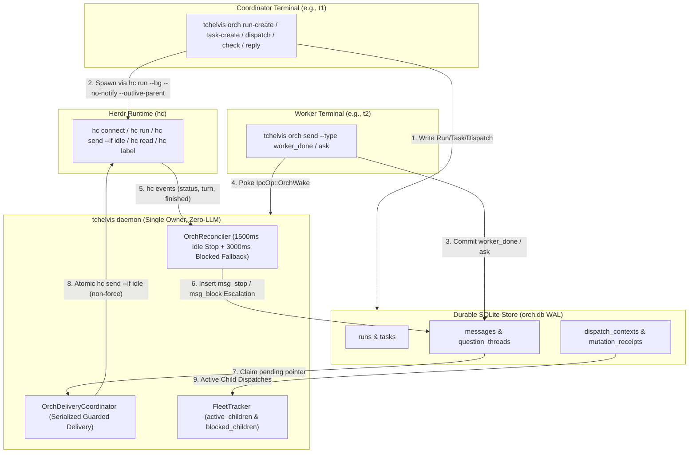

# Tchelvis M6 — Multi-Agent Orchestration & Delegator Mode

*   **Author:** notchelvis
*   **Status:** Draft
*   **Date:** 2026-11-18

--------------------------------------------------------------------------------

## Overview

Tchelvis M6 adds event-driven parent-child agent orchestration (`tchelvis orch`) over Herdr (`hc`) terminals. Inspired by the Orca ADE orchestration architecture and T3 Code delegation, it lets a coordinator agent running inside a Herdr terminal spawn or attach worker agents in child terminals, assign tasks with structured preambles, and end its turn without polling.

A local SQLite mailbox (`orch.db` in WAL mode) and the always-on `tchelvis daemon` (`src/daemon.rs`, which consumes the live `hc events --json` stream without requiring a local LLM loaded in RAM/VRAM) coordinate all parent-child communication. Children report completion (`worker_done`), ask blocking questions (`ask`), or escalate failures (`escalation`) through `tchelvis orch` CLI subcommands. If a worker returns to its prompt (`idle` or `done` for `>= 1500ms` after its turn advances past dispatch), errors out, or remains blocked on an interactive prompt (`[y/N]` or question) beyond a 3000ms supervisor grace window (`BLOCKED_SUPERVISOR_GRACE_MS = 3_000`, e.g. when the supervisor LLM is `unloaded` or the command is outside the read-only fast-path whitelist), `tchelvis daemon` automatically synthesizes an idempotent escalation event. In all cases, `tchelvis daemon` wakes the target parent (or child, on `reply`) using Herdr's atomic server-side guarded send (`hc send --if idle <terminal> "<pointer>"`, non-force), so the coordinator manages worker lifecycles automatically even when the local supervisor LLM is unloaded.

## The Problem

When a developer uses a coordinator agent inside Herdr to decompose work across multiple coding agents (Claude Code, Codex, OpenCode, and Pi), current workflows break down in four ways:

*   **Manual Relay or Wasteful Polling Loops:** Without an event-driven wake mechanism and a structured mailbox, either the human user must watch child terminals and copy-paste results back to the parent session, or the parent agent must block inside `hc wait` / `sleep` + `hc read` loops that tie up the parent turn, prevent handling concurrent `ask` questions across tasks, and risk tool timeouts.
*   **Silent Worker Stops and Unhandled Blocks When the Supervisor LLM is Unloaded:** A worker agent may finish its turn without calling a completion command, crash mid-task, or block on a non-trivial permission prompt (`[y/N]`) while the user has the local supervisor LLM `unloaded` (`watcher.rs:278`). Without a zero-LLM daemon safety net and a grace-period fallback to the parent coordinator, the worker stalls indefinitely.
*   **Terminal Buffer Corruption from Raw Multi-Kilobyte Output Injection:** Pasting multi-kilobyte worker reports directly into a parent agent's PTY input buffer corrupts TUI composers (Claude Code, Codex, OpenCode, and Pi), triggers bracketed-paste quirks, or interleaves concurrent child completions.
*   **Ambiguous Fleet Status for Waiting Coordinators:** A coordinator that has dispatched children and is waiting for their results appears ambiguously as generic `idle` or `working` in the fleet dashboard (`FleetTracker`, `tchelvis status`, and the Herdr Desktop mod), hiding which active child terminals it is waiting on.

Tchelvis solves this by combining a durable SQLite orchestration store (`runs`, `tasks`, `dispatch_contexts`, `messages`, `question_threads`, `mutation_receipts`), a lightweight CLI (`tchelvis orch`), atomic guarded pointer delivery via `hc send --if idle` serialized by `tchelvis daemon`, and a deterministic reconciler (`1500ms` idle turn-stop hysteresis + `3000ms` blocked-prompt fallback when the supervisor LLM is unloaded or declines auto-reply).

## Goals

*   **Zero-Polling Parent-Child Lifecycle (`tchelvis orch`):** Provide CLI subcommands (`launch`, `run-create`, `task-create`, `dispatch`, `send`, `check`, `ask`, `reply`, `retry`, `stop`, `status`, `release`, `skill`) so any shell-capable agent can spawn workers via `hc run --bg --no-notify --outlive-parent`, pass task instructions with an auto-generated orchestration preamble, and end its turn immediately.
*   **Atomic Guarded Pointer Wakeup over `hc` (`< 2s` wake latency once idle):** Wake parent and child terminals by injecting a single-line pointer to the pending inbox (see §4) via Herdr's atomic `terminal.send` (`hc send --if idle <terminal> "<pointer>"`, without `--force`), serialized by `tchelvis daemon` and persisted in SQLite (`pointer_state`, `pointer_terminal`, `delivery_attempts`).
*   **Zero-LLM Safety Net & Unloaded-LLM Fallback (`1500ms` idle / `3000ms` blocked hysteresis):** Inside `tchelvis daemon`, detect when a dispatched child terminal:
    1. remains at its prompt (`idle` / `done`) for `>= 1500ms` (`WORKER_DONE_QUIET_MS`) after `turn > turn_at_dispatch` without `worker_done` or an open `ask`;
    2. enters `error` or `finished` unexpectedly; or
    3. remains in `blocked` state for `>= 3000ms` (`BLOCKED_SUPERVISOR_GRACE_MS`) after the supervisor's read-only fast path (and optional loaded LLM) had first refusal—and automatically enqueue an idempotent `escalation` message (`msg_stop_<dispatch_id>_<turn>` or `msg_block_<dispatch_id>_<turn>`) with the last 25 sanitized lines (`capture_lines`) of `hc read` output to wake the parent.
*   **Attempt Fencing and Per-Task Circuit Breaking:** Bind every dispatch to `(assignee_terminal, terminal_created_ms, dispatch_id)` so stale terminals cannot close newer dispatches, and trip a per-task circuit breaker (`tasks.status = 'circuit_broken'`) after 3 consecutive dispatch failures (`tasks.failure_count >= 3`).
*   **First-Class `active_children` / Waiting-on-Children Visibility:** Track active child terminals (`active_children: Vec<String>`) alongside `blocked_children: Vec<String>` on `AgentRow` in `FleetTracker`, `CockpitSnapshot`, `tchelvis status`, and the Herdr Desktop mod ([`assets/herdr-app/mods/tchelvis/main.js`](/home/ubuntu/.t3/projects/cockpit/assets/herdr-app/mods/tchelvis/main.js)) so a coordinator with live child dispatches renders as `Waiting on children (N)`.

## Non-Goals

*   **MCP Server for Orchestration:** Tchelvis will not expose orchestration tools via an MCP server in M6. Like Orca ADE and `hc --skill`, Tchelvis uses CLI subcommands + an on-demand skill command (`tchelvis orch skill`) so all agent CLIs work uniformly without permanent MCP schema token overhead.
*   **LLM Summarization inside the Supervisor Wake Path:** The wake and turn-stop safety net runs inside `tchelvis daemon` and remains strictly deterministic (zero-LLM), working identically whether the supervisor LLM container/Ollama is loaded or unloaded.
*   **Cross-Machine Federation in M6:** Remote host pairing and federated relay tables are out of scope for M6; all orchestrated terminals run against the local Herdr core (`hc`).
*   **Automatic Git Merge or Destructive Auto-Release:** While `tchelvis orch dispatch` supports optional git worktree creation (`--worktree current | new-child`), merging branches and releasing worktrees (`tchelvis orch release`) remain explicit coordinator/operator actions and never delete dirty or unmerged worktrees automatically.

## Critical User Journeys (CUJs)

### CUJ 1: Parent Dispatches Workers and Receives Automatic Completion Wakeup

*   **Given**: A coordinator agent is running in Herdr terminal `t1` (`HC_TERMINAL_ID=t1`) and `tchelvis daemon` is active (or auto-spawned by `tchelvis orch`).
*   **When**: The coordinator creates a run (`tchelvis orch run-create --title "Auth refactor"`), creates and dispatches tasks via `tchelvis orch dispatch --run run_01 --task task_a --title "Implement JWT" --prompt "..." --agent claude --worktree new-child`, and ends its turn. Worker `t2` finishes its work and executes `tchelvis orch send --type worker_done --outcome succeeded --dispatch-id disp_01 --body "Implemented module X and passed cargo test"`.
*   **Then**: `tchelvis` atomically records the message in `orch.db`, marks `disp_01` and `task_a` as `completed`, promotes any DAG tasks depending on `task_a` from `pending` to `ready`, and notifies `tchelvis daemon` via `IpcOp::OrchWake`. The daemon delivers the compact pointer to `t1` via `hc send --if idle t1 "<pointer>"`. `t1` wakes up, runs `tchelvis orch check --run run_01`, reads the structured completion report, and continues orchestration without human intervention.

### CUJ 2: Silent Worker Turn-Stop Caught by Zero-LLM Daemon Safety Net

*   **Given**: Worker `t3` was dispatched under coordinator `t1` (`disp_02`, `turn_at_dispatch = 0`), advances its turn (`turn = 1`), completes its response, and returns to its interactive CLI prompt (`status = idle`), but forgets to execute `tchelvis orch send --type worker_done`.
*   **When**: `tchelvis daemon` observes `t3` with `turn > turn_at_dispatch` in `idle` state for `>= 1500ms` (`WORKER_DONE_QUIET_MS`) with `disp_02` still in `dispatched` state and no open `question_threads` entry.
*   **Then**: `tchelvis daemon` captures the last 25 sanitized lines of `t3` via `hc read`, inserts an idempotent `escalation` message (`id = msg_stop_disp_02_1`, `reason = "worker_returned_to_prompt_without_worker_done"`) into `t1`'s mailbox, transitions `disp_02` to `needs_review`, and wakes `t1` via `hc send --if idle` so `t1` can inspect `t3` or send a follow-up prompt.

### CUJ 3: Worker Blocks on Question (`ask` ↔ `reply`) or Permission Prompt with Unloaded LLM

*   **Given**: Worker `t4` is executing `disp_03` for coordinator `t1` while the local supervisor LLM is `unloaded`.
*   **When**: Either (a) `t4` runs `tchelvis orch ask --dispatch-id disp_03 --question "Should token expiry default to 15m or 1h?"` and ends its turn, or (b) `t4` hits a non-readonly `[y/N]` permission prompt that remains `blocked` for `>= 3000ms` (`BLOCKED_SUPERVISOR_GRACE_MS`) because the supervisor's read-only fast path does not match and the LLM is unloaded.
*   **Then**: In case (a), `tchelvis` records an open row in `question_threads`, marks `disp_03` as `waiting_for_reply`, and wakes `t1`; when `t1` runs `tchelvis orch reply --question-id q_01 --body "Use 15m"`, `tchelvis daemon` delivers the answer to `t4`'s mailbox and wakes `t4`. In case (b), `tchelvis daemon` synthesizes an idempotent `escalation` message (`id = msg_block_disp_03_1`, `reason = "worker_blocked_on_prompt"`) with the OSC 7501 `status.msg` and screen tail, waking `t1` so the coordinator can inspect or alert the user.

--------------------------------------------------------------------------------

## Technical Plan (Architecture)

### 1. Existing System Context & Architectural Overview

#### Existing Herdr (`hc`) & Tchelvis Primitives
*   **Herdr Core (`hc`)**: The terminal runtime that hosts persistent agent PTY sessions. Every terminal has an address (`t1`, `t2`, exposed inside the PTY as `$HC_TERMINAL_ID`) and a live `HcTerminal` record ([`src/herdr.rs:40-76`](/home/ubuntu/.t3/projects/cockpit/src/herdr.rs#L40-L76)) containing `state` (`"live"` or `"finished"`), `created_ms` (immutable creation timestamp for that terminal instance), `turn` (monotonic agent turn counter incremented on each turn), `parent` (optional parent terminal address), `labels` (`BTreeMap<String, String>`), and `status` (OSC 7501 agent status: `"idle"`, `"working"`, `"done"`, `"blocked"`, `"error"`, plus optional `kind` and `msg`).
*   **`tchelvis daemon` vs. `WatcherEngine`**: Tchelvis has two distinct runtime components (retaining the internal `Cockpit*` Rust struct prefix after the binary rename from `cockpit` to `tchelvis`, per Decision D1 in [`ROADMAP.md:177`](/home/ubuntu/.t3/projects/cockpit/ROADMAP.md#L177)):
    1.  `tchelvis daemon` ([`src/daemon.rs`](/home/ubuntu/.t3/projects/cockpit/src/daemon.rs)): An always-on, zero-LLM asynchronous Tokio service that consumes the real-time `hc events --json` stream, maintains `FleetTracker` in memory with millisecond precision, serves the Unix domain socket (`tchelvis.sock`), and publishes `CockpitSnapshot` to the Herdr Desktop Mod.
    2.  `WatcherEngine` ([`src/supervisor/watcher.rs`](/home/ubuntu/.t3/projects/cockpit/src/supervisor/watcher.rs)): The synchronous supervisor poll loop (`tchelvis supervisor watch` / `tui`) that runs the zero-LLM read-only permission fast path (`Pass 1`, lines 229–242) and, **only when the local LLM is loaded (`llm_available`)**, evaluates non-trivial blocked prompts (`Pass 2`, line 278).

#### M6 Orchestration Architecture
Because the local LLM in `WatcherEngine` may be `unloaded` at any time (and `WatcherEngine::tick` runs on a 12-second second-granularity cadence), **`tchelvis daemon` (`src/daemon.rs`) is the single execution owner of M6 orchestration reconciliation and pointer delivery**:

1.  **The Agent CLI Surface (`tchelvis orch <subcommand>`)**: Stateless CLI commands executed by parent and child agents. Mutations commit to `orch.db` and send a lightweight `IpcOp::OrchWake` poke over `tchelvis.sock` (auto-spawning `tchelvis daemon` if absent, matching `tchelvis status`).
2.  **The Durable SQLite Orchestration Store (`$XDG_DATA_HOME/tchelvis/orch.db`)**: Configured in WAL mode (`PRAGMA journal_mode = WAL; PRAGMA synchronous = NORMAL; PRAGMA busy_timeout = 5000; PRAGMA foreign_keys = ON;`). All `hc` subprocess/RPC calls run **outside** SQLite transactions.
3.  **The Atomic Guarded Pointer Delivery Engine (`OrchDeliveryCoordinator` in `tchelvis daemon`)**: Serializes wakeups per target terminal using Herdr's native guarded `terminal.send` (`hc send --if idle <target_terminal> "<pointer>"`, without `--force`), which atomically pastes and submits Enter inside `herdr-core` while waiting for human drafts (`draft_wait`) and refusing `blocked` or non-idle terminals.
4.  **The Zero-LLM Turn-Stop & Unloaded-LLM Fallback Reconciler (`OrchReconciler` in `tchelvis daemon`)**: Driven by `hc events` status/turn transitions and a 500ms daemon timer whenever active dispatches exist. It synthesizes `msg_stop_<dispatch_id>_<turn>` after `1500ms` of post-turn idle/done without `worker_done`, and `msg_block_<dispatch_id>_<turn>` if a worker remains `blocked` for `>= 3000ms` (after `WatcherEngine`'s read-only fast path or loaded LLM had first refusal).
5.  **The Fleet Visibility Layer (`FleetTracker::active_children_map`, `AgentRow.active_children`, & Herdr Desktop Mod)**: Projects `active_children: Vec<String>` alongside `blocked_children: Vec<String>` into `CockpitSnapshot` so waiting coordinators display `"Waiting on children (N)"`.



### 2. SQLite Data Model (`orch.db`)

`OrchStore` (in [`src/orch/store.rs`](/home/ubuntu/.t3/projects/cockpit/src/orch/store.rs)) manages an isolated SQLite database at `CockpitPaths::orch_db_file()` (`$XDG_DATA_HOME/tchelvis/orch.db`) with six tables:

*   **`runs`**:
    *   Columns: `id PRIMARY KEY`, `title`, `coordinator_terminal` (e.g., `t1`), `coordinator_created_ms` (from `HcTerminal.created_ms`), `status` (`active | completed | archived`), `created_at_ms`, `updated_at_ms`.
*   **`tasks`** (DAG of work items within a run, composite `PRIMARY KEY (run_id, id)`):
    *   Columns: `id`, `run_id`, `title`, `prompt`, `deps_json` (JSON array of prerequisite `task_id`s within the same `run_id`), `failure_count` (incremented on dispatch failure; trips `status = 'circuit_broken'` at `>= 3`), `status` (`pending | ready | dispatched | completed | failed | blocked | circuit_broken`), `result_summary`, `created_at_ms`, `updated_at_ms`.
    *   Invariant: When a task transitions to `completed`, any `pending` task in the same run whose `deps_json` are all `completed` transitions to `ready`. When a task transitions to `failed` or `circuit_broken`, dependent `pending` tasks transition to `blocked`.
*   **`dispatch_contexts`** (Fenced execution attempts):
    *   Columns: `id PRIMARY KEY`, `run_id`, `task_id`, `parent_terminal`, `assignee_terminal` (e.g., `t2`), `terminal_created_ms` (immutable `HcTerminal.created_ms` of `assignee_terminal`, used for attempt fencing), `turn_at_dispatch` (`HcTerminal.turn` at spawn/attach time), `agent_kind` (`claude | codex | gemini | opencode | pi | <custom_cmd>`), `worktree_mode` (`current | new-child`), `worktree_path`, `depth` (`1 <= depth <= 2`), `status` (`starting | dispatched | waiting_for_reply | needs_review | completed | failed | stopped | superseded`), `idle_since_ms` (tracks 1500ms post-turn quiet window), `blocked_since_ms` (tracks 3000ms supervisor grace window), `created_at_ms`, `updated_at_ms`.
*   **`messages`** (Persistent mailbox & pointer delivery state machine):
    *   Columns: `id PRIMARY KEY` (`msg_<ts_hex>_<hash4>`, deterministic `msg_stop_<dispatch_id>_<turn>`, or `msg_block_<dispatch_id>_<turn>`), `run_id`, `task_id`, `dispatch_id`, `from_handle`, `to_handle`, `target_terminal` (resolved recipient terminal address, e.g., `t1` or `t2`), `msg_type` (`worker_done | question | reply | escalation | status | directive`), `outcome` (`succeeded | failed | null`), `body`, `pointer_state` (`pending | delivered | acknowledged | delivery_stalled`), `pointer_terminal`, `delivery_attempts` (default `0`, max `3`), `next_retry_at_ms`, `delivered_at_ms`, `acknowledged_at_ms`, `created_at_ms`.
*   **`question_threads`** (`ask` ↔ `reply` correlation):
    *   Columns: `id PRIMARY KEY`, `run_id`, `dispatch_id`, `question_msg_id`, `reply_msg_id`, `status` (`open | answered | cancelled`), `created_at_ms`, `answered_at_ms`.
*   **`mutation_receipts`** (CLI `--request-id` idempotency):
    *   Columns: `request_id PRIMARY KEY`, `command`, `response_json`, `created_at_ms`.

### 3. CLI Subcommand Surface (`tchelvis orch`)

All mutating subcommands accept `[--request-id <id>]` (deduplicated via `mutation_receipts`) and `[--json]`, execute all `hc` calls outside SQLite transactions, and send `IpcOp::OrchWake` to `tchelvis daemon` after committing:

1.  `tchelvis orch launch --agent <claude|codex|gemini|opencode|pi|<custom_cmd>> --prompt <str> [--title <str>] [--run <run_id>] [--worktree <current|new-child>] [--caller <term>] [--request-id <id>] [--json]`:
    *   One-shot launcher that preflights the mapped agent executable on `PATH` **before** creating any `runs`, `tasks`, or `dispatch_contexts` row; on missing binary, fails with structured JSON `{ "failed_stage": "agent_preflight", "agent": ..., "detail": ... }`.
    *   When `--run` is omitted, creates the run bound to the resolved caller as coordinator (`create_run_record`), creates an auto-ID task, and reuses `execute_dispatch`. Spawn/launch failures surface `{ "failed_stage": "spawn" | "launch", "exit_code": ..., "output_tail": ..., "detail": ..., "run_id": ..., "task_id": ..., "dispatch_id": ... }` cleanly to stdout when `--json` is passed, and also include `run_id`, `task_id`, and `dispatch_id` (plus the `tchelvis orch retry <dispatch_id>` command when a dispatch row exists) in the text error message.
2.  `tchelvis orch run-create [--title <str>] [--coordinator <term>] [--caller <term>] [--request-id <id>] [--json]`:
    *   Resolves coordinator terminal from `--coordinator` or strict caller resolution (`--caller` / `$HC_TERMINAL_ID`), reads `created_ms` from `hc get <term> --json`, inserts into `runs`, and sets `hc label <term> cockpit.orch.role=coordinator cockpit.orch.run=<run_id>`.
3.  `tchelvis orch task-create --run <run_id> --id <task_id> --title <str> --prompt <str> [--deps <csv_or_json>] [--request-id <id>] [--json]`:
    *   Validates DAG dependencies; sets `status = 'ready'` if all `deps` are `completed` (or empty), else `'pending'`.
4.  `tchelvis orch dispatch --run <run_id> --task <task_id> [--title <str>] [--prompt <str>] [--terminal <existing_term> | --agent <claude|codex|gemini|opencode|pi|<custom_cmd>>] [--worktree <current|new-child>] [--caller <term>] [--request-id <id>] [--json]`:
    *   If `<task_id>` does not exist yet and `--prompt` is provided, creates the task row inline (supporting one-step dispatch as in CUJ 1).
    *   Enforces per-task circuit breaker (`tasks.failure_count < 3`) and recursion depth (`depth <= 2`, derived by checking whether the caller terminal itself is an active `assignee_terminal` in `dispatch_contexts`).
    *   If `--worktree new-child` is requested, resolves `<repo_root>` from the coordinator terminal's `effective_cwd()` via `resolve_git_workspace` ([`src/correlate.rs:154`](/home/ubuntu/.t3/projects/cockpit/src/correlate.rs#L154)) and executes `git -C <repo_root> worktree add -B orch/<run_id>/<task_id> <repo_root>/.work/orch-<run_id>-<task_id> HEAD` (reusing the existing checkout if `<worktree_path>/.git` already exists, e.g., on `retry`).
    *   Builds the structured dispatch preamble (`build_dispatch_preamble`) containing `Run ID`, `Task ID`, `Dispatch ID`, exact `tchelvis orch send --type worker_done` / `tchelvis orch ask` commands, the non-polling rule, and the requirement to stop immediately after reporting `worker_done` (no further turns unless woken by a coordinator directive).
    *   Spawns the worker via Herdr's native `hc run --bg --no-notify --outlive-parent --parent <coord> --cwd <cwd> --label cockpit.orch.role=worker --label cockpit.orch.run=<run_id> --label cockpit.orch.task=<task_id> --label cockpit.orch.dispatch=<dispatch_id> --label cockpit.parent=<coord> --json <agent_cmd> "<preamble>"` (mapping `codex` to `codex --no-daemon`, `claude` to `claude`, `opencode` to `opencode`, `pi` to `pi`, `gemini` to `gemini`, or passing `<custom_cmd>`; or attaching to `--terminal <existing_term>` via `HerdrClient::send_guarded`).
    *   Inspects `first_message` on the returned `HcTerminal` (`HcFirstMessage { sent, reason, .. }`): if `matches!(term.first_message, Some(ref fm) if !fm.sent)` or `term.state == "finished"` / `term.status_name() == Some("error")`, increments `tasks.failure_count`, transitions the dispatch to `needs_review`, and enqueues an immediate `escalation` message for the parent; if `term.first_message.is_none()` (raw non-template binary argv launch) and `term.turn == 0` while idle/done, delivers the preamble via `send_guarded`.
5.  `tchelvis orch send`:
    *   **Worker -> Parent** (`--type <worker_done|escalation|status> [--outcome <succeeded|failed>] --dispatch-id <id> [--task-id <id>] --body <str>`):
        *   Verifies attempt fencing: the caller's terminal and live `HcTerminal.created_ms` must match `(assignee_terminal, terminal_created_ms)` on `dispatch_contexts`.
        *   In a short `BEGIN IMMEDIATE` transaction: inserts the message into `messages` (`pointer_state = 'pending'` for `worker_done` and `escalation`; `pointer_state = 'acknowledged'` for informational `status` messages so heartbeats do not wake the parent), updates `dispatch_contexts.status` and `tasks.status`, and promotes dependent tasks to `ready` (or marks them `blocked` on `failed`).
    *   **Parent -> Worker** (`--to dispatch:<dispatch_id> --body <str> [--caller <term>]`):
        *   Strictly fenced on the parent coordinator (`disp.parent_terminal` and `run.coordinator_created_ms`).
        *   Rejects dispatches whose `HcTerminal` is missing or `state == "finished"` (or already in a non-active status) with an actionable hint derived from `DispatchStatus::is_retryable()`: suggesting `tchelvis orch retry <dispatch_id>` for retryable statuses (`stopped`, `failed`, `needs_review`, etc.), or stating that the task already finished and suggesting `tchelvis orch launch --run <run_id> ...` for `completed` dispatches.
        *   If the worker is live and `--body` is a single line `<= 500` chars, attempts immediate delivery via `HerdrClient::send_guarded` (`hc send --if idle` when `idle`, `hc get` recheck then plain `hc send` when `done`) and records a `directive` message in `messages` as `acknowledged`; if busy (`working`, `blocked`, `error`, `unknown`, `status_mismatch`, `send_timeout`) or multi-line/long, records it as `pending` so `DeliveryScheduler` delivers a `[tchelvis] You have N orchestration message(s)...` pointer when ready, and surfaces the message history in `tchelvis orch status`.
    *   Sends `IpcOp::OrchWake` to `tchelvis daemon`.
6.  `tchelvis orch ask --dispatch-id <id> --question <str> [--request-id <id>] [--json]`:
    *   Fences against `(assignee_terminal, terminal_created_ms)`, inserts a `question` message and an `open` row in `question_threads`, sets `dispatch_contexts.status = 'waiting_for_reply'`, pokes `IpcOp::OrchWake`, and prints: `"Question recorded. End your turn immediately; Tchelvis will wake this terminal when the coordinator replies."`
7.  `tchelvis orch reply --question-id <q_id> --body <str> [--request-id <id>] [--json]`:
    *   Marks `question_threads.status = 'answered'`, restores `dispatch_contexts.status = 'dispatched'`, resets `idle_since_ms = None`, records the current `turn_at_dispatch` baseline, inserts a `reply` message targeting the child's `assignee_terminal`, and pokes `IpcOp::OrchWake`.
8.  `tchelvis orch retry <dispatch_id> [--caller <term>] [--request-id <id>] [--json]` & `tchelvis orch stop <dispatch_id> [--caller <term>] [--request-id <id>] [--json]`:
    *   Both enforce strict parent fencing (`disp.parent_terminal` + `run.coordinator_created_ms`).
    *   `retry`: checks `DispatchStatus::is_retryable()` (refusing `completed` and `superseded`) and the per-task circuit breaker (`failure_count < MAX_DISPATCH_FAILURES` and `task.status != CircuitBroken`), closes the previous worker terminal (`hc kill` + `hc rm` if present), marks the previous dispatch `superseded`, cancels any open `question_threads`, resets the task to `ready`, and launches a fresh dispatch for the same `(run_id, task_id, agent_kind, worktree_mode)` (reusing any existing `--worktree new-child` checkout).
    *   `stop`: closes the worker terminal (`hc kill` + `hc rm` if present), marks the dispatch `stopped`, cancels any open `question_threads`, and restores an active task to `ready` without incrementing `failure_count` and without deleting dirty or unmerged worktrees.
    *   **Recovery Path (`send -> retry -> stop`)**: Silence is never proof of exit—a worker that stops reporting may be idle awaiting direction (`orch send --to dispatch:<id> --body ...`), dead/stuck requiring a fresh attempt (`orch retry <id>`), or intentionally cancelled (`orch stop <id>`).
9.  `tchelvis orch check [--run <run_id>] [--terminal <term>] [--peek] [--json]`:
    *   Always scopes message retrieval to `target_terminal = <caller_terminal>` (from strict caller resolution; `--terminal` is only allowed when `--peek` is set or when invoked by a human shell outside an orchestration worker), applying `--run <run_id>` as an additional `AND run_id = ?` filter.
    *   Unless `--peek` is passed, atomically marks claimed rows `pointer_state = 'acknowledged'` and `acknowledged_at_ms = now_ms`, and outputs the structured digest of messages, newly `ready` or `blocked` DAG tasks, and active child dispatch statuses.
10. `tchelvis orch status [--run <run_id>] [--json]`, `tchelvis orch release --dispatch-id <id> [--force] [--json]`, and `tchelvis orch skill`:
    *   `status` displays the full run DAG, dispatch statuses, message log (including coordinator `directive` messages), open questions, and unacknowledged mailbox counts.
    *   `release` is strictly opt-in: terminates the finished worker terminal (`hc kill` + `hc rm`), marks `dispatch_contexts.status = 'stopped'` if not already terminal, and, if `worktree_mode == 'new-child'`, removes `<repo_root>/.work/orch-<run_id>-<task_id>` (`git -C <repo_root> worktree remove <worktree_path>`) only after verifying `git -C <worktree_path> status --porcelain` is empty and `git -C <repo_root> merge-base --is-ancestor orch/<run_id>/<task_id> HEAD` exits 0 (unless `--force` is explicitly provided). Even with `--force`, `release` removes only the worktree checkout and **keeps** the `orch/<run_id>/<task_id>` branch (which may hold unmerged commits), printing `branch kept: orch/<run_id>/<task_id>, delete with git branch -D orch/<run_id>/<task_id>` (and `branch_kept` in `--json`). Finished workers are never auto-closed without an explicit `stop`, `retry`, or `release`.
    *   `skill` prints the self-contained Markdown orchestration guide for coordinator and worker agents (paralleling `hc --skill`).

### 4. Atomic Guarded Pointer Delivery (`src/orch/delivery.rs`)

Instead of an open-loop two-phase `hc keys enter` workaround, `OrchDeliveryCoordinator` (running exclusively inside `tchelvis daemon`) leverages Herdr's native server-side guarded `terminal.send` (`hc send --if idle <target_terminal> "<pointer>"`, without `--force`):

1.  **Single-Writer Serialization & Coalescing**:
    *   `tchelvis daemon` is the sole process that injects pointers into Herdr terminals.
    *   If a target terminal already has a message in `pointer_state = 'delivered'` (unacknowledged by `tchelvis orch check`) and `now_ms < next_retry_at_ms`, no new pointer line is injected—newly arrived messages coalesce into the pending inbox that the target will read on its next `tchelvis orch check`.
2.  **Defense-in-Depth Safety Guard (`is_terminal_safe_for_pointer`)**:
    *   Before calling `hc`, `tchelvis daemon` checks `FleetTracker::effective_attention(target_terminal, now_ms)`: if the terminal is in **any** `AttentionState::Blocked { .. }` (`Auth`, `Permission`, `Question`, or `Unknown`) or is not `Idle` / `Done`, delivery is deferred.
    *   As a second layer inside `herdr-core`, `hc send --if idle` (without `--force`) atomically verifies that the terminal status is `idle`, waits for ~3s of terminal quiet and up to `draft_wait` (60s) for any human unfinished typing draft, and refuses delivery with exit code `9` (`blocked`) or `10` (`status_mismatch`) if the terminal changed state.
3.  **Canonical Pointer Format & Delivery Transition (`pending -> delivered -> acknowledged`)**:
    *   `tchelvis daemon` formats the single-line pointer:
        `[tchelvis] You have N orchestration message(s) in run <run_id>. Run: tchelvis orch check --run <run_id>`
    *   Invokes `hc send --if idle <target_terminal> "<pointer>"`.
    *   On success, marks all pending messages for `(target_terminal, run_id)` as `pointer_state = 'delivered'`, `pointer_terminal = target_terminal`, `delivered_at_ms = now_ms`, `delivery_attempts = delivery_attempts + 1`, and `next_retry_at_ms = now_ms + 30_000`.
    *   If the target terminal remains `idle` for `>= 30s` without running `tchelvis orch check`, `tchelvis daemon` retries delivery up to `MAX_DELIVERY_ATTEMPTS = 3` before transitioning `pointer_state` to `delivery_stalled`.

### 5. Zero-LLM Turn-Stop Safety Net, Unloaded-LLM Fallback & Waiting-on-Children Visibility

Inside `tchelvis daemon` ([`src/daemon.rs`](/home/ubuntu/.t3/projects/cockpit/src/daemon.rs)) and `FleetTracker` ([`src/herdr.rs`](/home/ubuntu/.t3/projects/cockpit/src/herdr.rs)):

1.  **1500ms Post-Turn Idle Reconciler (`WORKER_DONE_QUIET_MS = 1_500`)**:
    *   On every `hc events` status/turn/finished event and 500ms daemon reconciliation tick, `OrchReconciler` inspects active `dispatch_contexts` (`status == 'dispatched'`) against `FleetTracker::terminals` (`HcTerminal` from `terminal.list {all: true}`).
    *   If `term.status` is `"working"`, resets `idle_since_ms = None` and `blocked_since_ms = None`.
    *   If `term.turn > disp.turn_at_dispatch` and `term.status` is `"idle"` or `"done"` (or the agent exited back to a plain shell foreground):
        *   Sets `idle_since_ms = Some(now_ms)` if unset.
        *   Once `now_ms - idle_since_ms >= 1_500` and no `worker_done` or open `question_threads` exists, captures the last 25 sanitized lines (`capture_lines`) via `hc read` + `extract_tail_lines` ([`src/supervisor/hc.rs:700`](/home/ubuntu/.t3/projects/cockpit/src/supervisor/hc.rs#L700)), inserts an idempotent `escalation` message with deterministic ID `msg_stop_<dispatch_id>_<turn>` (`INSERT OR IGNORE`, `reason = "worker_returned_to_prompt_without_worker_done"`), transitions the dispatch to `needs_review`, and wakes the parent via `OrchDeliveryCoordinator`.
    *   If `term.state == "finished"` or `term.status == "error"` (or the terminal disappeared from `hc` or its `created_ms != Some(disp.terminal_created_ms)`), immediately synthesizes `msg_stop_<dispatch_id>_<turn>` (`reason = "worker_exited_or_errored"`, using `disp.turn_at_dispatch` if `term` is absent) and transitions the dispatch to `needs_review`.
2.  **3000ms Unloaded-LLM / Unhandled Blocked-Prompt Fallback (`BLOCKED_SUPERVISOR_GRACE_MS = 3_000`)**:
    *   When a dispatched worker enters `AttentionState::Blocked { .. }`:
        *   During the first `3000ms` (`blocked_since_ms`), `tchelvis daemon` gives `WatcherEngine` first refusal: if `WatcherEngine` is running, its zero-LLM read-only fast path (`watcher.rs:229-242`) or loaded LLM (`watcher.rs:278`) can auto-approve safe prompts and return the worker to `working`.
        *   If the worker is **still** `blocked` after `>= 3000ms` (for example, because the user has the supervisor LLM `unloaded`, `WatcherEngine` is in `AlertOnly`/`Paused` mode, or the prompt requires a non-trivial decision), `OrchReconciler` checks `store.has_message("msg_block_<dispatch_id>_<turn>")` first (so `hc read` runs at most once per block event) and synthesizes an idempotent `escalation` message `msg_block_<dispatch_id>_<turn>` (`reason = "worker_blocked_on_prompt"`) containing `term.status.msg` and the last 25 screen lines, waking the parent coordinator so the worker never stalls silently when the LLM is unloaded.
3.  **`active_children` & Waiting-on-Children Visibility**:
    *   Adds `#[serde(default)] pub active_children: Vec<String>` alongside `pub blocked_children: Vec<String>` on both `AgentRow` ([`src/model.rs:429-436`](/home/ubuntu/.t3/projects/cockpit/src/model.rs#L429-L436)) and `AgentSummaryRow` ([`src/model.rs:549-610`](/home/ubuntu/.t3/projects/cockpit/src/model.rs#L549-L610), mirrored in `AgentSummaryRow::from_agent_row`), populated by `FleetTracker::active_children_map(&active_orch_children)` without changing `AttentionState` enum variants. Both `FleetTracker::active_children_map` and `FleetTracker::blocked_children_map` share parent resolution (`HcTerminal.parent` with fallback to `labels["cockpit.parent"]`), and `active_children_map` includes only live child terminals that are either (a) in an active orchestration dispatch (`status IN ('starting', 'dispatched', 'waiting_for_reply')` from `OrchStore::active_dispatches_by_parent`) or (b) non-orchestrated live children whose `effective_attention` is `Working` or `Blocked { .. }` (so completed worker terminals waiting for opt-in `release` do not keep the parent in `"Waiting on children (N)"`).
    *   When a coordinator row is `Idle` or `Done` with non-empty `active_children`, `tchelvis status` and the Herdr Desktop Mod ([`assets/herdr-app/mods/tchelvis/main.js`](/home/ubuntu/.t3/projects/cockpit/assets/herdr-app/mods/tchelvis/main.js)) render the badge `"Waiting on children (N)"`.

--------------------------------------------------------------------------------

## Alternatives Considered

### Alternative A: Expose Orchestration Tools via an Always-On MCP Server

*   **Pros**: Native tool-call syntax (`mcp_tchelvis_dispatch`, `mcp_tchelvis_send`) for agents that support MCP; structured JSON schema validation handled by the model's tool-calling layer.
*   **Cons**: Injects a tool schema for every M6 subcommand (10 subcommands) into the context window of every coding agent session even when orchestration is not used; requires per-agent `.mcp.json` / config registration across Claude Code, Codex, OpenCode, Pi, and Gemini CLI; and cannot push asynchronous wakeups into an idle agent session on its own (still requires PTY delivery when a child completes after the parent's turn has ended).
*   **Reason for Rejection**: Following the Orca ADE and `hc --skill` pattern, CLI subcommands (`tchelvis orch <cmd>`) combined with `tchelvis orch skill` and the dispatch preamble work across every shell-capable agent CLI without permanent MCP schema token overhead, while using the exact same `hc send --if idle` wake mechanism for asynchronous turn notifications.

### Alternative B: Parent Polling Loop (`sleep` + `hc read` or Blocking Wait inside Parent Turn)

*   **Pros**: Requires no asynchronous wakeup coordinator in `tchelvis daemon`; the parent simply blocks or loops in bash until the worker finishes.
*   **Cons**: Locks the parent agent's turn and shell tool execution (often hitting multi-minute tool timeouts on complex tasks); prevents the parent from handling concurrent `ask` questions or escalations across multiple children working in parallel; and wastes tokens and subprocess spawns if the parent repeatedly polls `hc read`.
*   **Reason for Rejection**: Violates the zero-polling design goal in [`ROADMAP.md`](/home/ubuntu/.t3/projects/cockpit/ROADMAP.md#L155-L172) where the coordinator delegates, ends its turn, and wakes reactively when any child finishes, asks a question, or triggers the turn-stop safety net.

### Alternative C: Direct Full-Payload PTY Injection (`hc send <parent> "<full worker report>"`)

*   **Pros**: Eliminates the `tchelvis orch check` step; the coordinator sees the worker's output immediately in its prompt as user input.
*   **Cons**: Multi-line or multi-kilobyte payloads pasted directly into TUI composers (Claude Code, Codex, OpenCode, and Pi) trigger bracketed-paste quirks or truncate long outputs. Furthermore, if multiple children finish while the parent is busy, full-payload sends queue multiple separate user turns instead of coalescing into a single inbox check.
*   **Reason for Rejection**: Persisting full payloads in SQLite (`orch.db`) and injecting at most one single-line compact pointer (`[tchelvis] You have N orchestration message(s) in run <run_id>...`) via `hc send --if idle` coalesces concurrent child completions into a single clean wake event and avoids TUI buffer corruption.

### Alternative D: LLM-Based Supervisor Summarization on Worker Turn-Stop

*   **Pros**: The Tchelvis supervisor (`OllamaClient` / `llama.cpp` container) could read the worker's screen when it goes idle and judge whether the worker finished its task or is waiting for follow-up.
*   **Cons**: Fails whenever the user has the local LLM container or Ollama model `unloaded` to save VRAM/RAM; adds seconds of inference latency (cf. `supervisor bench` measurements in [`ROADMAP.md`](/home/ubuntu/.t3/projects/cockpit/ROADMAP.md)) and non-deterministic classification errors when the coordinator agent itself already has full task context.
*   **Reason for Rejection**: Keeping the turn-stop and blocked-fallback reconciler 100% deterministic inside `tchelvis daemon` ensures orchestration works with zero VRAM overhead even when the supervisor LLM is unloaded, leaving judgment to the coordinator agent.

### Alternative E: Relying Exclusively on Raw Herdr Native Notes (`<hc from="...">`) and `hc wait --children` Without `orch.db`

*   **Pros**: Zero new SQLite tables or CLI commands; `hc run --bg` already types automatic `<hc>` notes into the parent terminal on child exit/stop, and `hc wait --children any` blocks until a child stops working.
*   **Cons**: Raw `hc` parent notes push uncoalesced text into the parent terminal for every child transition, lack a structured multi-message mailbox or task DAG state (`pending -> ready`), provide no correlated `ask` ↔ `reply` question threads or attempt fencing, and do not coordinate a 3000ms grace window with Tchelvis's read-only permission fast path when a child blocks on `[y/N]`.
*   **Reason for Rejection**: Tchelvis M6 builds on top of `hc`'s native process management (`hc run --bg --no-notify --outlive-parent` and `hc send --if idle`) while moving notification state into `orch.db` so messages coalesce cleanly, `ask`/`reply` threads are tracked, and `tchelvis daemon` coordinates seamlessly with the Tchelvis supervisor whether the local LLM is loaded or unloaded.

--------------------------------------------------------------------------------

## Non-Functional Requirements

*   **Concurrency, Storage Durability & Out-of-Transaction I/O (`orch.db` WAL)**: Multiple worker CLIs and `tchelvis daemon` access `orch.db` concurrently. `OrchStore` uses `PRAGMA journal_mode = WAL; PRAGMA synchronous = NORMAL; PRAGMA busy_timeout = 5000; PRAGMA foreign_keys = ON;`. All state mutations execute inside short `BEGIN IMMEDIATE` transactions (`< 5ms`), and **no `hc` subprocess or RPC call may ever execute while holding a SQLite transaction or mutex**. Inside `tchelvis daemon`, database mutations execute via `tokio::task::spawn_blocking` (or non-blocking short lock acquisitions after async `hc` I/O completes).
*   **Server-Side & Daemon-Side Guarded Pointer Delivery**: `OrchDeliveryCoordinator` only invokes `hc send --if idle <target_terminal> "<pointer>"` (never `--force`, and never raw `hc keys enter`) after confirming `FleetTracker::effective_attention` is not `AttentionState::Blocked { .. }` and no unacknowledged pointer is currently within its 30s retry window for that terminal.
*   **Idempotency & Attempt Fencing**: Retried CLI commands with the same `--request-id` return the cached `mutation_receipts` response without duplicating messages. Automated turn-stop and blocked-prompt escalations use deterministic IDs (`msg_stop_<dispatch_id>_<turn>` and `msg_block_<dispatch_id>_<turn>`) with `INSERT OR IGNORE` so consecutive daemon ticks never spam duplicate escalations.

--------------------------------------------------------------------------------

## Risks, Limits & Mitigations

*   **Risk 1 — Worker Blocks on First-Run Directory Trust Dialog at Spawn (`first_message.sent == false`)**:
    *   *Failure Mode*: When `--worktree new-child` creates a new directory, Claude Code or Codex may display a workspace trust prompt before accepting the initial task preamble, causing `hc run` to return `first_message: { sent: false, reason: ... }`.
    *   *Mitigation*: `tchelvis orch dispatch` inspects `first_message` on the returned `HcTerminal`. If `Some(HcFirstMessage { sent: false, .. })` (or `state == "finished"` / `status == "error"`), it records the reason, transitions the dispatch to `needs_review`, increments `tasks.failure_count`, and enqueues an immediate `escalation` message so the coordinator or operator can approve trust or retry.
*   **Risk 2 — `tchelvis daemon` Not Running When Orchestration Starts**:
    *   *Failure Mode*: If the user has not started `tchelvis daemon`, `IpcOp::OrchWake` and background 1500ms/3000ms reconciliation would not run.
    *   *Mitigation*: `tchelvis orch run-create` and `tchelvis orch dispatch` call `pub async fn ensure_daemon_running(paths: &CockpitPaths) -> Result<()>` in [`src/daemon.rs`](/home/ubuntu/.t3/projects/cockpit/src/daemon.rs) (spawning `tchelvis daemon` in the background if `tchelvis.sock` is unreachable), and `tchelvis doctor` reports `orch.db` and daemon health.
*   **Risk 3 — Local Supervisor LLM Unloaded When Worker Hits Non-Trivial `[y/N]` Prompt**:
    *   *Failure Mode*: When the supervisor LLM is unloaded (`watcher.rs:278`), `WatcherEngine` still auto-approves read-only fast-path prompts (`watcher.rs:229-242`), but non-whitelisted `[y/N]` prompts remain `blocked`.
    *   *Mitigation*: `OrchReconciler` in `tchelvis daemon` enforces a 3000ms grace window (`BLOCKED_SUPERVISOR_GRACE_MS = 3_000`) giving the read-only fast path (and loaded LLM, if active) first refusal. If the worker remains `blocked` past 3000ms, `tchelvis daemon` synthesizes `msg_block_<dispatch_id>_<turn>` and wakes the parent coordinator.
*   **Risk 4 — Unacknowledged Pointer Delivery / Busy Coordinator**:
    *   *Failure Mode*: A coordinator may be mid-turn (`working`) when a child completes, or may fail to run `tchelvis orch check` after receiving a pointer.
    *   *Mitigation*: When the coordinator is `working`, `hc send --if idle` is deferred and `pointer_state` stays `pending` until `hc events` reports the coordinator transitioned to `idle`/`done`. Once `delivered`, if the pointer remains unacknowledged after `30s` while the terminal is `idle`, `tchelvis daemon` retries up to `MAX_DELIVERY_ATTEMPTS = 3` before marking `pointer_state = 'delivery_stalled'`.
*   **Risk 5 — Unmerged or Dirty Worktree Deletion on `release`**:
    *   *Failure Mode*: Releasing a worker worktree automatically or prematurely could destroy uncommitted changes or unmerged commits.
    *   *Mitigation*: There is no automatic background worktree reaper in M6. `tchelvis orch release` is strictly opt-in and refuses to remove `<repo_root>/.work/orch-<run_id>-<task_id>` if `git -C <worktree_path> status --porcelain` is non-empty or `git -C <repo_root> merge-base --is-ancestor orch/<run_id>/<task_id> HEAD` fails, unless `--force` is passed. Even when `--force` is passed, `release` removes only the worktree directory and keeps the `orch/<run_id>/<task_id>` branch so unmerged commits are preserved (`branch kept: ..., delete with git branch -D ...`).

--------------------------------------------------------------------------------

## Detailed Implementation Plan

### Target Files to Create/Modify

#### 1. [`src/orch/mod.rs`](/home/ubuntu/.t3/projects/cockpit/src/orch/mod.rs) (Create)

*   **Type / Scope**: Rust Module Root (Orchestration Domain Models, ID Generator & Constants)
*   **Rationale**: Centralizes the serializable domain structs, enums, outcome structs, and deterministic-dependency ID generator shared by `tchelvis orch` CLI and `tchelvis daemon`.
*   **Proposed Changes**:
    *   Export submodules `pub mod store;`, `pub mod preamble;`, `pub mod delivery;`, `pub mod reconciler;`, and `pub mod cli;`.
    *   Define constants:
        *   `pub const WORKER_DONE_QUIET_MS: i64 = 1_500;`
        *   `pub const BLOCKED_SUPERVISOR_GRACE_MS: i64 = 3_000;`
        *   `pub const POINTER_RETRY_BACKOFF_MS: i64 = 30_000;`
        *   `pub const MAX_DELIVERY_ATTEMPTS: i32 = 3;`
        *   `pub const MAX_DISPATCH_FAILURES: i32 = 3;`
        *   `pub const MAX_ORCH_DEPTH: i32 = 2;`
    *   Implement `pub fn generate_orch_id(prefix: &str) -> String` using `chrono::Utc::now().timestamp_millis()`, `std::process::id()`, and a process-wide `AtomicU64` counter hashed with `sha2::Sha256` (`format!("{prefix}_{ts_ms:x}_{hash_prefix_4}")`, requiring no new crates in `Cargo.toml`).
    *   Define `#[derive(Debug, Clone, PartialEq, Eq, Serialize, Deserialize)]` structs and string-serialized enums (`#[serde(rename_all = "snake_case")]`):
        *   `OrchRun { pub id: String, pub title: String, pub coordinator_terminal: String, pub coordinator_created_ms: i64, pub status: RunStatus, pub created_at_ms: i64, pub updated_at_ms: i64 }` (`RunStatus`: `Active | Completed | Archived`)
        *   `OrchTask { pub id: String, pub run_id: String, pub title: String, pub prompt: String, pub deps: Vec<String>, pub failure_count: i32, pub status: TaskStatus, pub result_summary: Option<String>, pub created_at_ms: i64, pub updated_at_ms: i64 }` (`TaskStatus`: `Pending | Ready | Dispatched | Completed | Failed | Blocked | CircuitBroken`)
        *   `DispatchContext { pub id: String, pub run_id: String, pub task_id: String, pub parent_terminal: String, pub assignee_terminal: String, pub terminal_created_ms: i64, pub turn_at_dispatch: u64, pub agent_kind: String, pub worktree_mode: String, pub worktree_path: Option<String>, pub depth: i32, pub status: DispatchStatus, pub idle_since_ms: Option<i64>, pub blocked_since_ms: Option<i64>, pub created_at_ms: i64, pub updated_at_ms: i64 }` (`DispatchStatus`: `Starting | Dispatched | WaitingForReply | NeedsReview | Completed | Failed | Stopped | Superseded`)
        *   `OrchMessage { pub id: String, pub run_id: String, pub task_id: Option<String>, pub dispatch_id: Option<String>, pub from_handle: String, pub to_handle: String, pub target_terminal: String, pub msg_type: MessageType, pub outcome: Option<String>, pub body: String, pub pointer_state: PointerState, pub pointer_terminal: Option<String>, pub delivery_attempts: i32, pub next_retry_at_ms: Option<i64>, pub delivered_at_ms: Option<i64>, pub acknowledged_at_ms: Option<i64>, pub created_at_ms: i64 }` (`MessageType`: `WorkerDone | Question | Reply | Escalation | Status | Directive`; `PointerState`: `Pending | Delivered | Acknowledged | DeliveryStalled`)
        *   `QuestionThread { pub id: String, pub run_id: String, pub dispatch_id: String, pub question_msg_id: String, pub reply_msg_id: Option<String>, pub status: String, pub created_at_ms: i64, pub answered_at_ms: Option<i64> }`
        *   `PendingPointerTarget { pub target_terminal: String, pub run_id: String, pub pending_count: usize, pub has_active_unexpired_pointer: bool }`
        *   `InboxCheckResult { pub target_terminal: String, pub run_id_filter: Option<String>, pub messages: Vec<OrchMessage>, pub ready_tasks: Vec<OrchTask>, pub blocked_tasks: Vec<OrchTask>, pub active_dispatches: Vec<DispatchContext> }`
        *   `DeliveryOutcome { pub delivered_count: usize, pub deferred_count: usize, pub stalled_count: usize }`
        *   `ReconcileOutcome { pub stop_escalations: usize, pub block_escalations: usize, pub state_changed: bool }`

#### 2. [`src/orch/store.rs`](/home/ubuntu/.t3/projects/cockpit/src/orch/store.rs) (Create)

*   **Type / Scope**: Rust SQLite Store (`rusqlite`, WAL mode, `Arc<Mutex<Connection>>`)
*   **Rationale**: Provides durable, concurrent-safe storage for parent-child runs, DAG tasks, fenced dispatch contexts, persistent mailbox messages, pointer delivery state, and idempotency receipts at `$XDG_DATA_HOME/tchelvis/orch.db`.
*   **Proposed Changes**:
    *   Implement `OrchStore { conn: Arc<Mutex<Connection>> }` with `OrchStore::open(path: &Path) -> Result<Self>` and `OrchStore::open_in_memory() -> Result<Self>`, executing:
        ```sql
        PRAGMA journal_mode = WAL;
        PRAGMA synchronous = NORMAL;
        PRAGMA busy_timeout = 5000;
        PRAGMA foreign_keys = ON;
        CREATE TABLE IF NOT EXISTS runs (
            id TEXT PRIMARY KEY,
            title TEXT NOT NULL,
            coordinator_terminal TEXT NOT NULL,
            coordinator_created_ms INTEGER NOT NULL,
            status TEXT NOT NULL,
            created_at_ms INTEGER NOT NULL,
            updated_at_ms INTEGER NOT NULL
        );
        CREATE TABLE IF NOT EXISTS tasks (
            run_id TEXT NOT NULL REFERENCES runs(id) ON DELETE CASCADE,
            id TEXT NOT NULL,
            title TEXT NOT NULL,
            prompt TEXT NOT NULL,
            deps_json TEXT NOT NULL DEFAULT '[]',
            failure_count INTEGER NOT NULL DEFAULT 0,
            status TEXT NOT NULL,
            result_summary TEXT,
            created_at_ms INTEGER NOT NULL,
            updated_at_ms INTEGER NOT NULL,
            PRIMARY KEY (run_id, id)
        );
        CREATE TABLE IF NOT EXISTS dispatch_contexts (
            id TEXT PRIMARY KEY,
            run_id TEXT NOT NULL REFERENCES runs(id) ON DELETE CASCADE,
            task_id TEXT NOT NULL,
            parent_terminal TEXT NOT NULL,
            assignee_terminal TEXT NOT NULL,
            terminal_created_ms INTEGER NOT NULL,
            turn_at_dispatch INTEGER NOT NULL DEFAULT 0,
            agent_kind TEXT NOT NULL,
            worktree_mode TEXT NOT NULL,
            worktree_path TEXT,
            depth INTEGER NOT NULL DEFAULT 1,
            status TEXT NOT NULL,
            idle_since_ms INTEGER,
            blocked_since_ms INTEGER,
            created_at_ms INTEGER NOT NULL,
            updated_at_ms INTEGER NOT NULL,
            FOREIGN KEY (run_id, task_id) REFERENCES tasks(run_id, id) ON DELETE CASCADE
        );
        CREATE TABLE IF NOT EXISTS messages (
            id TEXT PRIMARY KEY,
            run_id TEXT NOT NULL REFERENCES runs(id) ON DELETE CASCADE,
            task_id TEXT,
            dispatch_id TEXT,
            from_handle TEXT NOT NULL,
            to_handle TEXT NOT NULL,
            target_terminal TEXT NOT NULL,
            msg_type TEXT NOT NULL,
            outcome TEXT,
            body TEXT NOT NULL,
            pointer_state TEXT NOT NULL,
            pointer_terminal TEXT,
            delivery_attempts INTEGER NOT NULL DEFAULT 0,
            next_retry_at_ms INTEGER,
            delivered_at_ms INTEGER,
            acknowledged_at_ms INTEGER,
            created_at_ms INTEGER NOT NULL
        );
        CREATE TABLE IF NOT EXISTS question_threads (
            id TEXT PRIMARY KEY,
            run_id TEXT NOT NULL REFERENCES runs(id) ON DELETE CASCADE,
            dispatch_id TEXT NOT NULL REFERENCES dispatch_contexts(id) ON DELETE CASCADE,
            question_msg_id TEXT NOT NULL REFERENCES messages(id) ON DELETE CASCADE,
            reply_msg_id TEXT REFERENCES messages(id) ON DELETE SET NULL,
            status TEXT NOT NULL,
            created_at_ms INTEGER NOT NULL,
            answered_at_ms INTEGER
        );
        CREATE TABLE IF NOT EXISTS mutation_receipts (
            request_id TEXT PRIMARY KEY,
            command TEXT NOT NULL,
            response_json TEXT NOT NULL,
            created_at_ms INTEGER NOT NULL
        );
        CREATE INDEX IF NOT EXISTS idx_tasks_run_status ON tasks(run_id, status);
        CREATE INDEX IF NOT EXISTS idx_dispatches_status ON dispatch_contexts(status);
        CREATE INDEX IF NOT EXISTS idx_dispatches_assignee ON dispatch_contexts(assignee_terminal, status);
        CREATE INDEX IF NOT EXISTS idx_messages_target_pointer ON messages(target_terminal, pointer_state, run_id);
        ```
    *   Implement short atomic transactional methods (`BEGIN IMMEDIATE`, with zero external subprocess I/O):
        *   `pub fn get_mutation_receipt(&self, request_id: &str) -> Result<Option<String>>` & `pub fn save_mutation_receipt(&self, request_id: &str, command: &str, response_json: &str, now_ms: i64) -> Result<()>`
        *   `pub fn create_run(&self, run: &OrchRun) -> Result<()>`
        *   `pub fn get_run(&self, run_id: &str) -> Result<Option<OrchRun>>`
        *   `pub fn list_runs(&self) -> Result<Vec<OrchRun>>`
        *   `pub fn create_or_update_task(&self, task: &OrchTask) -> Result<OrchTask>` (validates prerequisite IDs in `task.deps`, computes initial `Ready` vs. `Pending` / `Blocked` status)
        *   `pub fn get_task(&self, run_id: &str, task_id: &str) -> Result<Option<OrchTask>>`
        *   `pub fn list_tasks(&self, run_id: &str) -> Result<Vec<OrchTask>>`
        *   `pub fn promote_or_block_dependent_tasks(&self, run_id: &str, now_ms: i64) -> Result<()>`
        *   `pub fn caller_orchestration_depth(&self, caller_terminal: &str, caller_created_ms: i64) -> Result<i32>` (returns `disp.depth + 1` if `caller_terminal` is an active `assignee_terminal`, else `1`)
        *   `pub fn create_dispatch(&self, disp: &DispatchContext) -> Result<()>` (enforces `task.failure_count < MAX_DISPATCH_FAILURES` and `disp.depth <= MAX_ORCH_DEPTH`, sets `tasks.status = 'dispatched'`)
        *   `pub fn get_dispatch(&self, dispatch_id: &str) -> Result<Option<DispatchContext>>`
        *   `pub fn list_active_dispatches(&self) -> Result<Vec<DispatchContext>>` (`status IN ('starting', 'dispatched', 'waiting_for_reply')`)
        *   `pub fn active_dispatches_by_parent(&self) -> Result<BTreeMap<String, Vec<String>>>` (maps `parent_terminal -> Vec<assignee_terminal>` for dispatches with `status IN ('starting', 'dispatched', 'waiting_for_reply')`)
        *   `pub fn update_dispatch_timers(&self, dispatch_id: &str, idle_since_ms: Option<i64>, blocked_since_ms: Option<i64>, now_ms: i64) -> Result<bool>`
        *   `pub fn update_dispatch_status(&self, dispatch_id: &str, status: DispatchStatus, now_ms: i64) -> Result<()>`
        *   `pub fn record_task_failure(&self, run_id: &str, task_id: &str, dispatch_id: Option<&str>, reason: &str, now_ms: i64) -> Result<TaskStatus>` (increments `tasks.failure_count`, sets `tasks.status` to `'circuit_broken'` at `>= 3` or `'failed'`, transitions dispatch to `'needs_review'`, enqueues an `escalation` message to `coordinator_terminal`, and calls `promote_or_block_dependent_tasks`)
        *   `pub fn record_worker_done(&self, dispatch_id: &str, caller_terminal: &str, caller_created_ms: i64, outcome: &str, body: &str, now_ms: i64) -> Result<OrchMessage>` (verifies `(assignee_terminal, terminal_created_ms)` fencing, updates dispatch & task status, promotes/blocks DAG dependents, and inserts `worker_done` message with `pointer_state = 'pending'`)
        *   `pub fn record_worker_message(&self, dispatch_id: &str, caller_terminal: &str, caller_created_ms: i64, msg_type: MessageType, body: &str, now_ms: i64) -> Result<OrchMessage>` (fenced `Status` inserted with `pointer_state = 'acknowledged'`; fenced `Escalation` inserted with `pointer_state = 'pending'`)
        *   `pub fn record_question(&self, dispatch_id: &str, caller_terminal: &str, caller_created_ms: i64, question_body: &str, now_ms: i64) -> Result<(QuestionThread, OrchMessage)>`
        *   `pub fn record_reply(&self, question_id: &str, reply_body: &str, child_current_turn: u64, now_ms: i64) -> Result<(QuestionThread, OrchMessage)>`
        *   `pub fn has_message(&self, msg_id: &str) -> Result<bool>`
        *   `pub fn record_turn_stop_escalation(&self, dispatch_id: &str, turn: u64, reason: &str, tail_preview: &str, now_ms: i64) -> Result<Option<OrchMessage>>` (`INSERT OR IGNORE` with `id = format!("msg_stop_{dispatch_id}_{turn}")`, transitioning dispatch to `NeedsReview`)
        *   `pub fn record_blocked_escalation(&self, dispatch_id: &str, turn: u64, status_msg: Option<&str>, tail_preview: &str, now_ms: i64) -> Result<Option<OrchMessage>>` (`INSERT OR IGNORE` with `id = format!("msg_block_{dispatch_id}_{turn}")`)
        *   `pub fn requeue_expired_pointers(&self, now_ms: i64) -> Result<usize>` (transitions `delivered` rows where `now_ms >= next_retry_at_ms` back to `pending` if `delivery_attempts < MAX_DELIVERY_ATTEMPTS`, or to `delivery_stalled` if `delivery_attempts >= MAX_DELIVERY_ATTEMPTS`)
        *   `pub fn pending_pointer_targets(&self, now_ms: i64) -> Result<Vec<PendingPointerTarget>>`
        *   `pub fn mark_pointer_delivered(&self, target_terminal: &str, run_id: &str, now_ms: i64) -> Result<usize>`
        *   `pub fn claim_inbox_messages(&self, target_terminal: &str, run_id_filter: Option<&str>, peek: bool, now_ms: i64) -> Result<InboxCheckResult>` (strictly scoped to `target_terminal`).

#### 3. [`src/orch/preamble.rs`](/home/ubuntu/.t3/projects/cockpit/src/orch/preamble.rs) (Create)

*   **Type / Scope**: Rust Module (Worker Dispatch Preamble & On-Demand Skill Text)
*   **Rationale**: Standardizes the deterministic Markdown preamble injected into every spawned/attached worker terminal and provides the Markdown text output for `tchelvis orch skill`.
*   **Proposed Changes**:
    *   Implement `pub fn build_dispatch_preamble(run_id: &str, task_id: &str, dispatch_id: &str, parent_terminal: &str, depth: i32, task_prompt: &str) -> String` outputting:
        ```markdown
        [TCHELVIS ORCHESTRATION WORKER CONTRACT]
        Run ID: <run_id> | Task ID: <task_id> | Dispatch ID: <dispatch_id> | Parent: <parent_terminal> | Depth: <depth>/2

        Mandatory Rules:
        1. When your task is complete, report back before ending your turn:
           tchelvis orch send --type worker_done --outcome succeeded --dispatch-id <dispatch_id> --body "<concise summary of changes and verification>"
        2. If you fail or cannot complete the task, report failure:
           tchelvis orch send --type worker_done --outcome failed --dispatch-id <dispatch_id> --body "<failure reason>"
        3. If you need clarification from the coordinator, ask and then end your turn immediately (never poll or sleep):
           tchelvis orch ask --dispatch-id <dispatch_id> --question "<question>"
        4. If you receive a `[tchelvis] You have N orchestration message(s)...` pointer, run:
           tchelvis orch check --run <run_id>

        [TASK PROMPT]
        <task_prompt>
        ```
    *   Implement `pub fn orchestration_skill_markdown() -> &'static str` documenting the coordinator workflow (`run-create`, `task-create`, `dispatch`, ending the turn to wait for automatic `[tchelvis]` pointer wakeups, running `tchelvis orch check --run <id>` when woken or if no pointer arrives and the user asks for results, `reply`, `status`, and opt-in `release`).

#### 4. [`src/orch/delivery.rs`](/home/ubuntu/.t3/projects/cockpit/src/orch/delivery.rs) (Create)

*   **Type / Scope**: Rust Module (Non-Blocking Status-Aware Guarded Pointer Delivery Scheduler)
*   **Rationale**: Wakes parent or child terminals from `tchelvis daemon` without blocking the event loop, dispatching to `HerdrClient::send_guarded_with_mode` (`hc send --if idle` when `idle`; `hc get` re-check right before plain `hc send` when `done`) with single-outstanding-pointer coalescing, per-target in-flight tracking, 10 s timeout (`deferred(send_timeout)`), exponential backoff (`250ms`–`5s` cap), and transition-only logging (`tchelvis.log`).
*   **Proposed Changes**:
    *   Define `pub struct DeliveryScheduler` (used by `run_daemon`) and `pub struct OrchDeliveryCoordinator` (convenience async driver):
        1. Call `store.requeue_expired_pointers_detailed(now_ms)?` and `store.pending_pointer_targets(now_ms)?` (dropping the `OrchStore` mutex guard immediately before any async `hc` call).
        2. For each `PendingPointerTarget` where `!has_active_unexpired_pointer` and `pending_count > 0`, skip if a send to `target_terminal` is already in-flight or backoff (`250ms` doubling to `5000ms`, reset on tracker status change or `Sent`) has not elapsed, and classify via `classify_terminal_for_send`: `idle` -> `GuardedSendMode::IfIdle`; `done` -> `GuardedSendMode::DoneRecheckThenPlain`; `working`, `blocked`, `error`, `unknown`, or `finished` -> deferred without spawning `hc`.
        3. Format canonical pointer `[tchelvis] You have N orchestration message(s) in run <run_id>. Run: tchelvis orch check --run <run_id>` and spawn `herdr.send_guarded_with_mode(&target.target_terminal, &pointer, mode, send_timeout)` (default 10 s; daemon `select!` handles `delivery_scheduler.recv_completed()`).
        4. On `GuardedSendOutcome::Sent`, call `store.mark_pointer_delivered(&target.target_terminal, &target.run_id, now_ms)?` and always emit `outcome="sent"`. On `Deferred` (including `status_mismatch` with parsed `detail`, or `send_timeout`) or `Error`, leave rows `pending`, update per-target backoff, and log only on `(outcome, reason, detail, tracker_status)` transitions with `attempts`.
        5. Unified daemon/CLI structured logs write to `$XDG_STATE_HOME/tchelvis/tchelvis.log` (`tchelvis update` / `procs::restart` redirects stdio to `/dev/null` and reports `tchelvis.log` instead of creating an empty `daemon.log`).

#### 5. [`src/orch/reconciler.rs`](/home/ubuntu/.t3/projects/cockpit/src/orch/reconciler.rs) (Create)

*   **Type / Scope**: Rust Module (Zero-LLM 1500ms Turn-Stop & 3000ms Blocked Fallback Reconciler)
*   **Rationale**: Ensures the parent coordinator is woken when a child agent finishes its turn silently (`>= 1500ms` after `turn > turn_at_dispatch`), exits/errors out, disappears/restarts, or remains blocked on a prompt (`>= 3000ms`, covering when the supervisor LLM is unloaded).
*   **Proposed Changes**:
    *   Define `pub struct OrchReconciler;` and implement `pub async fn reconcile_active_dispatches(store: &OrchStore, herdr: &HerdrClient, tracker: &FleetTracker, now_ms: i64) -> Result<ReconcileOutcome>`:
        1. Fetch `store.list_active_dispatches()?` (dropping the SQLite mutex guard immediately).
        2. For each `disp` with `disp.status == DispatchStatus::Dispatched`:
            *   Look up `term = tracker.terminals.get(&disp.assignee_terminal)`.
            *   **Disappeared / Restarted / Exited / Errored Terminal**: If `term` is `None`, or `term.created_ms != Some(disp.terminal_created_ms)`, or `term.state == "finished"`, or `term.status_name() == Some("error")`, determine `turn = term.map(|t| t.turn).unwrap_or(disp.turn_at_dispatch)`, optionally read the last 25 lines via `herdr.read_tail_lines(&disp.assignee_terminal, 25).await.unwrap_or_default()` only if `term.is_some()`, and call `store.record_turn_stop_escalation(&disp.id, turn, "worker_exited_or_errored", &tail, now_ms)?`.
            *   **Working Terminal**: If `term.status_name() == Some("working")` and `tracker.effective_attention(&disp.assignee_terminal, now_ms / 1000)` is `Some(AttentionState::Working)`, reset `(idle_since_ms, blocked_since_ms)` to `(None, None)` via `store.update_dispatch_timers`.
            *   **3000ms Blocked Fallback (`BLOCKED_SUPERVISOR_GRACE_MS = 3_000`)**: If `tracker.effective_attention(&disp.assignee_terminal, now_ms / 1000)` is `Some(AttentionState::Blocked { .. })`, set `blocked_since = disp.blocked_since_ms.unwrap_or(now_ms)` (updating `store.update_dispatch_timers` if previously `None`). Once `now_ms - blocked_since >= BLOCKED_SUPERVISOR_GRACE_MS`, check `let msg_id = format!("msg_block_{}_{}", disp.id, term.turn); if !store.has_message(&msg_id)?` (so `hc read` runs at most once per `(dispatch_id, turn)` block event), await `herdr.read_tail_lines(&disp.assignee_terminal, 25).await.unwrap_or_default()`, and call `store.record_blocked_escalation(&disp.id, term.turn, term.status_msg(), &tail, now_ms)?`.
            *   **1500ms Post-Turn Idle Safety Net (`WORKER_DONE_QUIET_MS = 1_500`)**: If `term.turn > disp.turn_at_dispatch` and `matches!(tracker.effective_attention(&disp.assignee_terminal, now_ms / 1000), Some(AttentionState::Idle | AttentionState::Done { .. }))` (or `term.is_plain_shell_foreground()`), set `idle_since = disp.idle_since_ms.unwrap_or(now_ms)`. Once `now_ms - idle_since >= WORKER_DONE_QUIET_MS`, await `herdr.read_tail_lines(&disp.assignee_terminal, 25).await.unwrap_or_default()` and call `store.record_turn_stop_escalation(&disp.id, term.turn, "worker_returned_to_prompt_without_worker_done", &tail, now_ms)?`.

#### 6. [`src/orch/cli.rs`](/home/ubuntu/.t3/projects/cockpit/src/orch/cli.rs) (Create)

*   **Type / Scope**: Rust CLI Subcommands Handler (`clap`)
*   **Rationale**: Implements `tchelvis orch` subcommands (`launch`, `run-create`, `task-create`, `dispatch`, `send`, `ask`, `reply`, `retry`, `stop`, `check`, `status`, `release`, `skill`) with `--request-id` receipt caching, `--json` serialization, worktree management, and `IpcOp::OrchWake` notification.
*   **Proposed Changes**:
    *   Define `#[derive(Subcommand, Debug, Clone)] pub enum OrchCommands` for all 13 subcommands and `pub async fn execute_orch_command(cmd: OrchCommands, cfg: &CockpitConfig, paths: &CockpitPaths) -> Result<()>`.
    *   On `launch`, `run-create`, `dispatch`, and `retry`, call `crate::daemon::ensure_daemon_running(paths).await?`. After every mutating command commits to `OrchStore`, send `IpcRequest { op: IpcOp::OrchWake, terminal: None }` to `paths.socket_file()` (ignoring socket errors if the daemon is restarting).
    *   In `launch`: preflight the mapped agent command binary on `PATH` before touching `orch.db` (`failed_stage: "agent_preflight"`), then create the run (when `--run` is omitted) and auto-ID task and delegate to `execute_dispatch`, surfacing structured `spawn` / `launch` errors with `exit_code` and `output_tail`.
    *   In `dispatch`:
        *   Map `--agent` presets (`"codex"` -> `"codex --no-daemon"`, `"claude"` -> `"claude"`, `"opencode"` -> `"opencode"`, `"pi"` -> `"pi"`, `"gemini"` -> `"gemini"`, or any custom command string).
        *   If `--worktree new-child`, resolve `repo_root` from the coordinator terminal's `effective_cwd()` via `crate::correlate::resolve_git_workspace` ([`src/correlate.rs:154`](/home/ubuntu/.t3/projects/cockpit/src/correlate.rs#L154)) and run `git -C <repo_root> worktree add -B orch/<run_id>/<task_id> <repo_root>/.work/orch-<run_id>-<task_id> HEAD` (reusing `<worktree_path>` if `.git` already exists).
        *   Spawn via `herdr.run_worker(...)` (or attach to `--terminal <existing_term>` by setting the 5 `cockpit.*` labels and delivering the preamble via `herdr.send_guarded`). Inspect `term.first_message`: if `Some(ref fm) if !fm.sent`, call `store.record_task_failure(...)`.
    *   In `send --to dispatch:<id> --body <str>`, `retry <dispatch_id>`, and `stop <dispatch_id>`: enforce strict parent fencing (`disp.parent_terminal` + `run.coordinator_created_ms`), deliver/queue coordinator directives (via `herdr.send_guarded`), supersede/relaunch attempts while respecting the circuit breaker, or close worker terminals cleanly without deleting dirty/unmerged worktrees.
    *   In `release`: verify `git -C <worktree_path> status --porcelain` is empty and `git -C <repo_root> merge-base --is-ancestor orch/<run_id>/<task_id> HEAD` exits 0 before running `git -C <repo_root> worktree remove <worktree_path>` (unless `--force` is passed), and terminate the worker terminal via `hc kill` + `hc rm`.

#### 7. [`src/lib.rs`](/home/ubuntu/.t3/projects/cockpit/src/lib.rs) & [`src/config.rs`](/home/ubuntu/.t3/projects/cockpit/src/config.rs) (Modify)

*   **Type / Scope**: Library Exports & Path Resolution
*   **Rationale**: Exposes `pub mod orch;` in the crate root and adds `CockpitPaths::orch_db_file(&self) -> PathBuf` pointing to `$XDG_DATA_HOME/tchelvis/orch.db`.
*   **Proposed Changes**:
    *   Add `pub mod orch;` to [`src/lib.rs`](/home/ubuntu/.t3/projects/cockpit/src/lib.rs).
    *   Add `pub fn orch_db_file(&self) -> PathBuf { self.data_dir.join("orch.db") }` to `CockpitPaths` in [`src/config.rs`](/home/ubuntu/.t3/projects/cockpit/src/config.rs).

#### 8. [`src/main.rs`](/home/ubuntu/.t3/projects/cockpit/src/main.rs) (Modify)

*   **Type / Scope**: Binary CLI Router, Label Whitelist & Status Output Formatter
*   **Rationale**: Wires `tchelvis orch <subcommand>` into `Commands`, whitelists orchestration label keys in `VALID_LABEL_KEYS`, and renders `"Waiting on children (N)"` in `tchelvis status` / `tchelvis inspect`.
*   **Proposed Changes**:
    *   Add `Orch { #[command(subcommand)] action: tchelvis::orch::cli::OrchCommands }` to `Commands` and dispatch it to `tchelvis::orch::cli::execute_orch_command`.
    *   Add `"cockpit.parent"`, `"cockpit.orch.role"`, `"cockpit.orch.run"`, `"cockpit.orch.task"`, and `"cockpit.orch.dispatch"` to `VALID_LABEL_KEYS` ([`src/main.rs:426-434`](/home/ubuntu/.t3/projects/cockpit/src/main.rs#L426-L434)).
    *   Update `print_human_status` ([`src/main.rs:1446-1484`](/home/ubuntu/.t3/projects/cockpit/src/main.rs#L1446-L1484)) so when `matches!(row.attention_state, AttentionState::Idle | AttentionState::Done { .. }) && !row.active_children.is_empty()`, the state column renders `format!("Waiting on children ({})", row.active_children.len())`, and update `print_human_inspect` ([`src/main.rs:1493-1495`](/home/ubuntu/.t3/projects/cockpit/src/main.rs#L1493-L1495)) to print `Active Children: ...` when `!a.active_children.is_empty()`.
    *   Delegate `try_autospawn_daemon` ([`src/main.rs:1409`](/home/ubuntu/.t3/projects/cockpit/src/main.rs#L1409)) to `tchelvis::daemon::ensure_daemon_running(&paths)`.

#### 9. [`src/herdr.rs`](/home/ubuntu/.t3/projects/cockpit/src/herdr.rs) (Modify)

*   **Type / Scope**: Async Herdr Client, `HcTerminal` Schema & Fleet State Tracker
*   **Rationale**: Deserializes `first_message` on `HcTerminal`, provides async `send_guarded` / `send_guarded_with_mode`, `run_worker`, and `read_tail_lines` helpers on `HerdrClient`, and computes `active_children_map` on `FleetTracker` alongside `blocked_children_map`.
*   **Proposed Changes**:
    *   Define `HcFirstMessage { #[serde(default)] pub sent: bool, #[serde(default)] pub reason: Option<String>, #[serde(default)] pub started: Option<bool>, #[serde(default)] pub turn: Option<u64> }` and add `#[serde(default)] pub first_message: Option<HcFirstMessage>` to `HcTerminal` ([`src/herdr.rs:40-76`](/home/ubuntu/.t3/projects/cockpit/src/herdr.rs#L40-L76)).
    *   Add to `HerdrClient` in [`src/herdr.rs`](/home/ubuntu/.t3/projects/cockpit/src/herdr.rs):
        *   `pub async fn send_guarded(&self, term: &HcTerminal, attention_override: Option<AttentionState>, text: &str, timeout: Option<Duration>) -> GuardedSendOutcome` and `pub async fn send_guarded_with_mode(...)`: classifies terminal status (`idle` -> `hc send --if idle`; `done` -> `hc get` re-check right before plain `hc send`; `working`/`blocked`/`error`/`unknown`/`finished` -> `Deferred`), parses `hc --json` errors (`kind`, `message`), and treats timeouts (~10 s default) as `GuardedSendOutcome::Deferred { reason: "send_timeout", .. }`.
        *   `pub async fn run_worker(&self, parent_terminal: &str, cwd: &Path, labels: &[(&str, &str)], agent_cmd: &str, first_message: &str) -> Result<HcTerminal>`: invokes `hc run --bg --no-notify --outlive-parent --parent <parent_terminal> --cwd <cwd> [--label k=v ...] --json <agent_cmd> <first_message>` and parses the resulting `HcTerminal` (calling `self.get_terminal(&term_id).await` if `hc run --json` returns a summary object).
        *   `pub async fn read_tail_lines(&self, terminal: &str, lines: usize) -> Result<String>`: invokes `hc read <terminal>` and applies `extract_tail_lines(&raw, lines)` ([`src/supervisor/hc.rs:700`](/home/ubuntu/.t3/projects/cockpit/src/supervisor/hc.rs#L700)).
    *   Share a parent resolution helper `fn resolved_parent(term: &HcTerminal) -> Option<&str> { term.parent.as_deref().or_else(|| term.labels.get("cockpit.parent").map(String::as_str)) }` between `FleetTracker::blocked_children_map` ([`src/herdr.rs:558-575`](/home/ubuntu/.t3/projects/cockpit/src/herdr.rs#L558-L575)) and `pub fn active_children_map(&self, active_orch_children: &BTreeMap<String, Vec<String>>, now_sec: i64) -> BTreeMap<String, Vec<String>>` (collecting live child terminals that are either listed in `active_orch_children` or have `effective_attention` in `Working | Blocked { .. }`).

#### 10. [`src/model.rs`](/home/ubuntu/.t3/projects/cockpit/src/model.rs), [`src/correlate.rs`](/home/ubuntu/.t3/projects/cockpit/src/correlate.rs) & [`src/daemon.rs`](/home/ubuntu/.t3/projects/cockpit/src/daemon.rs) (Modify)

*   **Type / Scope**: Snapshot Schema, Agent Row Builder & Daemon Event Loop
*   **Rationale**: Surfaces `active_children: Vec<String>` on `AgentRow` and `AgentSummaryRow`, adds `IpcOp::OrchWake` to the daemon socket protocol, preserves `build_initial_agent_row` test compatibility, and runs `reconcile_active_dispatches` + `deliver_pending_pointers` inside `tchelvis daemon`.
*   **Proposed Changes**:
    *   In [`src/model.rs`](/home/ubuntu/.t3/projects/cockpit/src/model.rs): add `#[serde(default)] pub active_children: Vec<String>` to both `AgentRow` and `AgentSummaryRow` (copying `row.active_children.clone()` in `AgentSummaryRow::from_agent_row`), and add `OrchWake` (`#[serde(rename = "orch_wake")]`) to `IpcOp`.
    *   In [`src/correlate.rs`](/home/ubuntu/.t3/projects/cockpit/src/correlate.rs):
        *   In `should_include_terminal` ([`src/correlate.rs:106-111`](/home/ubuntu/.t3/projects/cockpit/src/correlate.rs#L106-L111)), add `"cockpit.orch.role"` and `"cockpit.orch.run"` to the label allowlist so orchestrated terminals remain in `CockpitSnapshot` even if their foreground is a plain shell.
        *   In `build_initial_agent_row` ([`src/correlate.rs:411-570`](/home/ubuntu/.t3/projects/cockpit/src/correlate.rs#L411-L570)), keep the existing 4-argument signature (`(term, attention_state, blocked_children, now_sec)` so [`tests/integration_tests.rs:127`](/home/ubuntu/.t3/projects/cockpit/tests/integration_tests.rs#L127) compiles unchanged), initialize `active_children: Vec::new()`, and fall back `parent` ([`src/correlate.rs:555`](/home/ubuntu/.t3/projects/cockpit/src/correlate.rs#L555)) to `term.labels.get("cockpit.parent")`.
    *   In [`src/daemon.rs`](/home/ubuntu/.t3/projects/cockpit/src/daemon.rs):
        *   Expose `pub async fn ensure_daemon_running(paths: &CockpitPaths) -> Result<()>` (moving the auto-spawn logic from `src/main.rs:1409`).
        *   In `materialize_snapshot`, query `active_orch_children = orch_store.active_dispatches_by_parent().unwrap_or_default()`, compute `active_children_map = tracker.active_children_map(&active_orch_children, now_sec)`, and assign `row.active_children` for each agent row.
        *   In `run_daemon`, open `OrchStore::open(&paths.orch_db_file())?`, create `let (orch_wake_tx, mut orch_wake_rx) = tokio::sync::mpsc::channel::<()>(32);`, and pass `orch_wake_tx.clone()` into `handle_ipc_client`. On `IpcOp::OrchWake`, `handle_ipc_client` calls `let _ = orch_wake_tx.try_send(());` and writes `{"ok":true}\n` to `write_half`.
        *   In `run_daemon`'s `tokio::select!` loop, run `OrchReconciler::reconcile_active_dispatches` and `OrchDeliveryCoordinator::deliver_pending_pointers` on `orch_wake_rx.recv()`, `hc events` transitions, and a 500ms `tokio::time::interval`, calling `materialize_snapshot` + `publish_doc_snapshot` on the 500ms tick only when `reconcile_outcome.state_changed || delivery_outcome.delivered_count > 0 || delivery_outcome.stalled_count > 0`.

#### 11. [`src/doctor.rs`](/home/ubuntu/.t3/projects/cockpit/src/doctor.rs) (Modify)

*   **Type / Scope**: Diagnostic Health Checks
*   **Rationale**: Ensures `tchelvis doctor` verifies `orch.db` SQLite WAL schema health (`/.work/` is already present in [`.gitignore:14`](/home/ubuntu/.t3/projects/cockpit/.gitignore#L14)).
*   **Proposed Changes**:
    *   Add an `orch_db` check in [`src/doctor.rs`](/home/ubuntu/.t3/projects/cockpit/src/doctor.rs) calling `OrchStore::open(&paths.orch_db_file())` and pushing `DoctorCheck { name: "orch_db".into(), status: "ok" | "fail", detail: format!("SQLite WAL ready at {}", paths.orch_db_file().display()) }` (setting `has_fail = true` on `Err`).

#### 12. [`assets/herdr-app/mods/tchelvis/main.js`](/home/ubuntu/.t3/projects/cockpit/assets/herdr-app/mods/tchelvis/main.js) (Modify)

*   **Type / Scope**: Herdr Desktop Mod UI (`gpui-kit`)
*   **Rationale**: Propagates `active_children` and `cockpit.parent` fallback through `mergeFleetRows` and renders `"Waiting on children (N)"` in `renderAgentCard` and `renderInspector`.
*   **Proposed Changes**:
    *   In `mergeFleetRows` ([`assets/herdr-app/mods/tchelvis/main.js:1301-1302, 1378, 1447, 1513`](/home/ubuntu/.t3/projects/cockpit/assets/herdr-app/mods/tchelvis/main.js#L1301)): copy `active_children: enriched?.active_children ?? []` (at line 1301), `active_children: sa?.active_children ?? []` (at line 1378), and `active_children: []` (at lines 1447 and 1513), and fall back `parent` at line 1302 to `rowLabels?.["cockpit.parent"] ?? null`.
    *   In `renderAgentCard` ([`assets/herdr-app/mods/tchelvis/main.js:3612-3625, 3757-3769`](/home/ubuntu/.t3/projects/cockpit/assets/herdr-app/mods/tchelvis/main.js#L3612-L3625)) and `renderInspector` ([`assets/herdr-app/mods/tchelvis/main.js:7484-7501`](/home/ubuntu/.t3/projects/cockpit/assets/herdr-app/mods/tchelvis/main.js#L7484-L7501)): when `!isFinished && (a.status === "idle" || a.status === "done") && Array.isArray(a.active_children) && a.active_children.length > 0`, set the status badge label to `` `Waiting on children (${a.active_children.length})` `` with color `t.accent` and render the child sub-line `` `↳ Active children: ${a.active_children.join(", ")}` `` alongside existing `blocked_children` badges.

#### 13. [`ROADMAP.md`](/home/ubuntu/.t3/projects/cockpit/ROADMAP.md) & [`tests/orch_integration.rs`](/home/ubuntu/.t3/projects/cockpit/tests/orch_integration.rs) (Modify / Create)

*   **Type / Scope**: Documentation & Automated Integration Test Suite
*   **Rationale**: Updates M6 status in [`ROADMAP.md`](/home/ubuntu/.t3/projects/cockpit/ROADMAP.md) and verifies end-to-end parent-child orchestration invariants.
*   **Proposed Changes**:
    *   Create [`tests/orch_integration.rs`](/home/ubuntu/.t3/projects/cockpit/tests/orch_integration.rs) covering:
        1.  DAG task creation (including reusing `--id task_a` across multiple runs via composite `PRIMARY KEY (run_id, id)`), automatic `pending -> ready` promotion on `worker_done --outcome succeeded`, and `pending -> blocked` propagation on `outcome failed`.
        2.  Attempt fencing rejection when a mismatched `terminal_created_ms` tries to close a dispatch.
        3.  Per-task circuit breaker tripping (`tasks.status = 'circuit_broken'`) after 3 failed dispatch attempts (`tasks.failure_count >= 3`).
        4.  Atomic guarded pointer delivery (`hc send --if idle`) coalescing multiple messages, deferring when target is `Blocked` or `Working`, and retrying after 30s (`MAX_DELIVERY_ATTEMPTS = 3`).
        5.  Strict `target_terminal` scoping on `tchelvis orch check --run <run_id>` so a child worker cannot consume messages addressed to the parent coordinator.
        6.  1500ms post-turn (`turn > turn_at_dispatch`) hysteresis safety-net escalation (`msg_stop_<dispatch_id>_<turn>`), disappeared/restarted terminal escalation, and single-shot 3000ms blocked-prompt fallback escalation (`msg_block_<dispatch_id>_<turn>`) when the supervisor LLM is unloaded.
        7.  `FleetTracker::active_children_map` populating `AgentRow.active_children` and `AgentSummaryRow.active_children` while excluding completed workers waiting for opt-in `release`.

### Verification Plan

*   **Compilation/Build**: `cargo build --all-targets`
*   **Unit & Integration Tests**: `cargo test --all-targets` (including `tests/orch_integration.rs`) and `node --test tests/mod/fleet-tree.test.mjs`
*   **Static Analysis & Linting**: `cargo clippy --all-targets -- -D warnings` and `cargo fmt --all -- --check`
*   **Diagnostic & Store Check**: `cargo run -- setup --only herdr-mod` (if Herdr mod is installed locally) followed by `cargo run -- doctor` (verifies `state.db`, `orch.db`, and Herdr mod asset hashes)

--------------------------------------------------------------------------------

*Drafted with EGM*
